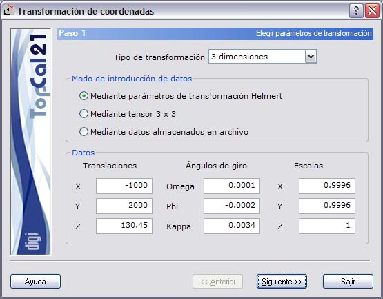

# Paso 1: Elegir parámetros de transformación
<!-- id: topcal21-transformacion-helmert-de-coordenadas-paso-1-elegir-parametros-de-transformacion -->

Este es el primer paso para calcular la transformación Helmert o Afín de coordenadas, en el que se indica el tipo de transformación y los parámetros que la definen. Los datos requeridos son los siguientes:

* **Tipo de transformación**: Puede ser *2 dimensiones*, *3 dimensiones* o *Afín*.
* **Forma de introducir los datos**:
  * *Mediante parámetros de transformación*: Estos parámetros son el vector de desplazamiento, ángulos de giro y factores de escala. El número de ellos variará en función del tipo de transformación elegida anteriormente.
  * *Mediante un tensor*: Este tensor será 2x2 ó 3x3 en función del tipo de transformación elegida anteriormente.
  * *Mediante datos almacenados en archivo*: El archivo deberá tener los campos necesarios para realizar la transformación correctamente. Este fichero puede ser creado con la herramienta [Transformación](../../herramientas/transformacion/README.md) del menú [Herramientas](../../menus-de-la-aplicacion/menu-herramientas.md). También puede crear el archivo con un editor de texto. La primera línea del archivo debe ser *\[Parametros_transformacion\]*, y los campos son los siguientes:
    * *Tipo*: Puede tomar las valores 0 (Helmert 2 dimensiones), 1 (Helmert 3 dimensiones), 2 (Helmert 2 dimensiones con centroide), 3 (Helmert 3 dimensiones con centroide), 4 (Afín) ó 5 (Afín con centroide)
    * *CalcularCentroide*: Si se desea calcular el centroide (1) o no (0).
    * *Escala*: Factor de escala para la transformación Helmert, en partes por millón (ppm).
    * *EscalaX*: Factor de escala del eje X para la transformación Afín en ppm.
    * *EscalaY*: Factor de escala del eje Y para la transformación Afín en ppm.
    * *GiroX*: Giro en torno al eje X en grados centesimales.
    * *GiroY*: Giro en torno al eje Y en grados centesimales.
    * *GiroZ*: Giro en torno al eje Z en grados centesimales. Si se trata de una transformación Helmert 2D, se tratará del ángulo de giro del sistema.
    * *DesplazamientoX*: Traslación del sistema en el eje X.
    * *DesplazamientoY*: Traslación del sistema en el eje Y.
    * *DesplazamientoZ*: Traslación del sistema en el eje Z.
    * *Centroide1X*: Valor de la coordenada X del centro de masas del sistema 1.
    * *Centroide1Y*: Valor de la coordenada Y del centro de masas del sistema 1.
    * *Centroide1Z*: Valor de la coordenada Z del centro de masas del sistema 1.
    * *Centroide2X*: Valor de la coordenada X del centro de masas del sistema 2.
    * *Centroide2Y*: Valor de la coordenada Y del centro de masas del sistema 2.
    * *Centroide2Z*: Valor de la coordenada Z del centro de masas del sistema 2.

Ejemplo:

\[Parametros_transformacion\]

Tipo=5

CalcularCentroide=1

Escala=0.0000000000

EscalaX=771634.7936731114

EscalaY=888075.2251650471

GiroX=105.4762242845

GiroY=98.0796746149

GiroZ=0.0000000000

DesplazamientoX=0.0000000000

DesplazamientoY=0.0000000000

DesplazamientoZ=0.0000000000

Centroide1X=573.3706666667

Centroide1Y=-153.6233333333

Centroide1Z=0.0000000000

Centroide2X=6000.0000000000

Centroide2Y=30931.0000000000

Centroide2Z=0.0000000000

Una vez introducidos estos datos se podrá pulsar el botón **Siguiente** para acceder al [Paso 2: Selección de puntos](paso-2-seleccion-de-puntos.md).
