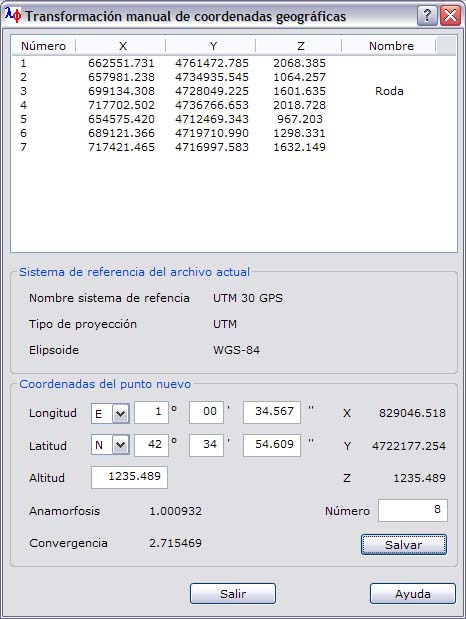

# Transformación manual de coordenadas geográficas
<!-- id: transformacion-manual-de-coordenadas-geograficas -->

Esta herramienta permite transformar coordenadas geográficas introducidas manualmente al sistema de referencia del archivo de puntos actual.

El programa muestra un cuadro de diálogo con un listado de coordenadas de los puntos almacenados en el archivo actual y las características del sistema de referencia donde se indica la proyección y el elipsoide utilizado.

Para añadir puntos nuevos se podrá indicar la **latitud** y la **longitud** geográficas introduciendo grados, minutos y segundos sexagesimales. Asimismo, habrá que indicar el hemisferio y si el punto está al este u oeste del meridiano origen. También se podrá introducir la **altitud** y el **número** del punto para añadir el punto apropiadamente al archivo pulsando el botón **Salvar**.

Al introducir las coordenadas geográficas, el programa calcula automáticamente las coordenadas transformadas referidas al sistema de coordenadas del archivo actual, la anamorfosis lineal y la convergencia de meridianos en grados sexagesimales.

