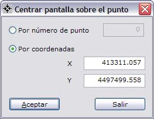

# Centrar pantalla sobre punto
<!-- id: centrar-pantalla-sobre-punto -->

El programa permite centrar la vista del croquis sobre unas coordenadas indicadas por el usuario o sobre un punto identificado por su número de punto.

