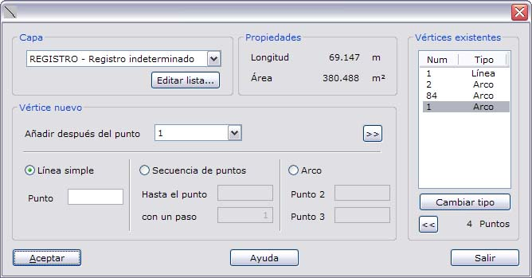

# Dibuja entidad
<!-- id: dibuja-entidad -->

Esta herramienta sirve para registrar entidades en el fichero de croquis a partir de los puntos relacionados con éste. Para ello se precisa de un código de entidad que se podrá elegir de la lista de códigos existente y del conocimiento de la secuencia de puntos que forma la entidad.

La forma de introducir los puntos puede ser uno a uno, a través de una secuencia continuada de puntos o puntos que conforman un arco.

El programa va mostrando los puntos que forman la entidad, la longitud de ésta y el área, si está cerrada.

Los campos que aparecen en este cuadro de diálogo son los siguientes:

* **Capa**: Se podrá elegir una capa para la entidad que se está registrando. Si la capa no se encuentra entre las mostradas puede mostrar el cuadro de diálogo [Lista de códigos](../opciones-de-visualizacion/preferencias-de-dibujo/listado-de-codigos-de-dibujo.md) mediante el botón **Editar lista** para añadir los deseados.
* **Propiedades**: En este apartado se muestra la **longitud** total de la línea registrada y el **área**, si coinciden el primer y último punto.
* **Vértice nuevo**: Con los campos que aquí aparecen se podrán añadir nuevos vértices a la línea pudiéndolo hacer de varias formas. En el campo **Añadir después del punto**, podrá seleccionar desde dónde quiere añadir puntos, de tal forma que podrá añadir puntos al principio, en medio o al final de la línea. La forma de introducción de vértices admite varias posibilidades:
  * **Línea simple**: Para introducir puntos sueltos.
  * **Secuencia de puntos**: Para introducir una secuencia ordenada de puntos, por ejemplo, los puntos desde el 100 hasta el 110, con paso 2: 100, 102, 104, 106, 108 y 110. El valor del **Paso** podrá ser negativo.
  * **Arco**: Para introducir un arco que pasa por tres puntos. Para registrar un arco se deberán introducir al menos dos puntos para generar el arco junto con el punto anterior. Sin embargo, si el arco está definido por más de tres puntos, se podrá rellenar únicamente el primer campo.

  Para aceptar el nuevo punto puede pulsar la tecla *\[Enter\]* o pulsar el botón **>>**.
* **Vértices existentes**: Se muestra un listado con los vértices existentes con su tipo y la cantidad de éstos, pudiendo eliminar algún punto de la lista pulsando el botón **&lt;&lt;**.
* **Cambiar tipo**: Cuando se selecciona un punto, se podrá cambiar el modo en el que participa en la línea, es decir, si será un segmento recto o parte de un arco. Cambiar el tipo de un punto puede cambiar también el tipo de otros puntos de la línea, ya que para registrar un arco se necesitan al menos dos puntos de tipo **Arco**.

