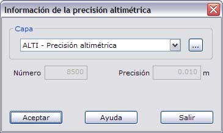

# Información de la precisión altimétrica
<!-- id: informacion-de-la-precision-altimetrica -->

En este cuadro de diálogo se muestran las propiedades de la precisión altimétrica de un punto cuando es seleccionada desde la vista de croquis. Los datos mostrados no podrán ser modificados, excepto la capa de dibujo en la cual está registrada la línea. Los datos mostrados son los siguientes:

* **Capa**: Capa de dibujo en la que está registrada la línea que representa la precisión altimétrica. Si en el listado no se encuentra la capa deseada se puede pulsar el botón que aparece a la derecha para crear una capa nueva.
* **Número**
* **Valor de la precisión altimétrica**

Pulse el botón **Aceptar** para guardar el cambio de capa. Pulse el botón **Salir** para cerrar el cuadro de diálogo.

