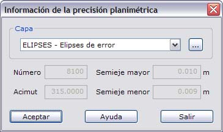

# Información de la precisión planimétrica
<!-- id: informacion-de-la-precision-planimetrica -->

En este cuadro de diálogo se muestran las propiedades de la precisión planimétrica de un punto cuando es seleccionada desde la vista de croquis. Los datos mostrados no podrán ser modificados, excepto la capa de dibujo en la cual está registrada la elipse de error. Los datos mostrados son los siguientes:

* **Capa**: Capa de dibujo en la que está registrada la elipse de error. Si en el listado no se encuentra la capa deseada se puede pulsar el botón que aparece a la derecha para crear una capa nueva.
* **Número**
* **Acimut del semieje mayor**
* **Semieje mayor de la elipse**
* **Semieje menor de la elipse**

Pulse el botón **Aceptar** para guardar el cambio de capa. Pulse el botón **Salir** para cerrar el cuadro de diálogo.

