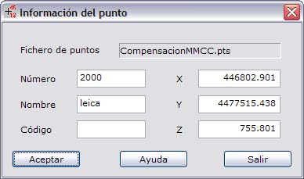

# Información del punto
<!-- id: informacion-del-punto -->

En este cuadro de diálogo se muestran las propiedades de un punto cuando es seleccionado desde la vista de croquis. Se podrán modificar los datos del punto; el programa guarda los datos modificados en el fichero de puntos al que pertenece el punto. Los datos mostrados son los siguientes:

* **Fichero de puntos**: Nombre del fichero al que pertenece el punto.
* **Número**
* **Nombre**
* **Código**
* **Coordenadas del punto**

Pulse el botón **Aceptar** para guardar los cambios del punto. Pulse el botón **Salir** para cerrar el cuadro de diálogo.

