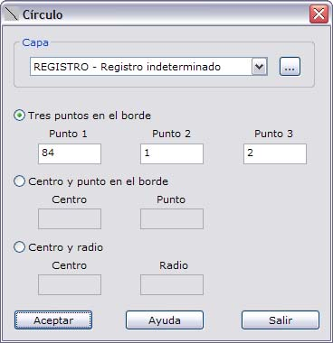

# Insertar círculo
<!-- id: insertar-circulo -->

Esta herramienta sirve para registrar entidades en forma de círculo cerrado a partir de la combinación de datos diversos: centro, radio, puntos en el límite, etc. El programa muestra un cuadro de diálogo donde se deberán indicar estos datos y el código o capa en el que se registrará la entidad.

En este cuadro de diálogo se podrá elegir el modo de introducir los datos del nuevo círculo. Estas opciones corresponden con la siguiente combinación de datos:

* **Tres puntos en el borde**: Se deberán indicar el número de tres puntos que se encuentren situados en el borde del círculo.
* **Centro y punto en el borde**: Se deberá indicar el número del punto que actúa de centro del círculo y un punto en el borde.
* **Centro y radio**: Se deberá indicar el número del punto que actúa de centro del círculo y el valor del radio del círculo en metros.

Si alguno de los puntos no existiera el programa mostrará un mensaje de error. Además, en el caso de las dos últimas opciones, para registrar la entidad, el programa necesita calcular puntos adicionales que se almacenarán en un listado propio del croquis.

Si en el listado de capas no se encontrara la capa deseada se puede pulsar el botón situado en la derecha para crear una capa nueva.

