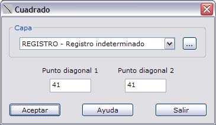

# Insertar cuadrado
<!-- id: insertar-cuadrado -->

Esta herramienta sirve para registrar entidades con forma cuadrada en el fichero de croquis a partir de dos puntos de una de las diagonales del cuadrado. El programa muestra un cuadro de diálogo donde se deberán indicar estos dos puntos y el código o capa en el que se registrará la entidad.

Si en el listado de capas no se encontrara la capa deseada se puede pulsar el botón situado en la derecha para crear una capa nueva.

Si alguno de los puntos no existiera el programa mostrará un mensaje de error. Además, para registrar la entidad, el programa necesita calcular dos puntos adicionales que se almacenarán en un listado propio del croquis.

