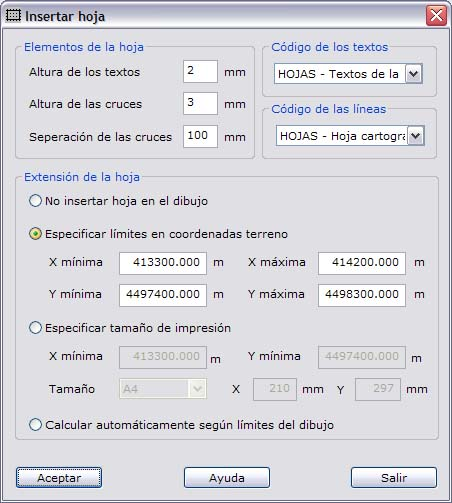

# Insertar hoja
<!-- id: topcal21-insertar-hoja -->

El programa permite incorporar automáticamente al dibujo un marco de hoja con cruces de referencia y coordenadas en los extremos. La introducción de esta hoja permitirá al usuario imprimir el documento teniendo referencia de las coordenadas en las que se encuentra el dibujo generado.

Esta hoja podrá ser introducida a partir de unas coordenadas en el mismo sistema de referencia que el dibujo, a partir de una hoja de impresión o automáticamente a partir de las extensiones del dibujo.

El programa muestra un cuadro de diálogo donde se podrá configurar la citada hoja y la forma de su inserción. Los campos que aparecen son los siguientes:

* **Elementos de la hoja**: Se indicarán las dimensiones de los elementos que va a contener la hoja. Dichas dimensiones vendrán determinadas en milímetros por lo que su tamaño en la pantalla dependerá de la **escala** a la que se encuentra el dibujo. Esta escala puede ser cambiada en las [propiedades del croquis](../opciones-de-visualizacion/propiedades-de-los-objetos/propiedades-del-archivo-de-croquis.md).
* **Altura de los textos**: Altura de los textos con las coordenadas que aparecerán en los márgenes de la hoja.
* **Altura de las cruces**: Altura de las cruces que aparecerán en el interior de la hoja.
* **Separación de las cruces**: Separación de las cruces de la hoja. En la intersección con los límites de las hojas es donde se ubicarán los textos con las coordenadas.
* **Códigos de los textos**: Código para registrar los textos con las coordenadas.
* **Códigos de las líneas**: Código para registrar los límites y las cruces de la hoja.
* **Extensión de la hoja**: Existen varias posibilidades para incluir la hoja:
  * **No insertar hoja en el dibujo**.
  * **Especificar límites en coordenadas terreno**: Se especificarían las coordenadas terreno, es decir, en el mismo sistema de referencia que el dibujo, de la esquina superior derecha y la inferior izquierda. La aplicación espera que los límites introducidos manualmente sean múltiplos de la separación entre cruces, para que las cruces queden repartidas en el interior de la hoja. Si no fuera así, el programa preguntará si se quieren hacer múltiplos o se mantienen dichos límites. Si se decide que el programa actúe para hacer los límites múltiplos, buscará las coordenadas mínimas más cercanas por debajo y las coordenadas máximas más cercanas por encima.
  * **Especificar tamaño de impresión**: Se puede especificar el tamaño de la hoja de impresión y las coordenadas de la esquina inferior izquierda donde se insertaría la hoja. Lógicamente, la forma de insertar la hoja de impresión, cuyas dimensiones vienen definidas en milímetros, vendrá condicionadas por la **escala** del dibujo.
  * **Calcular automáticamente en función de los límites del dibujo**: El programa puede calcular automáticamente la hoja que incluya todo el dibujo y cuyas coordenadas de las esquinas sean múltiplos de la separación de las cruces de la hoja.

