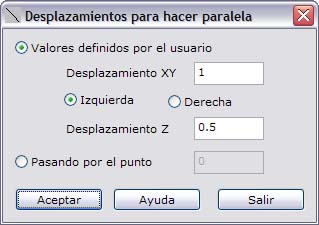

# Insertar paralela
<!-- id: insertar-paralela -->

Esta herramienta permitirá generar una paralela a una entidad registrada. Para ello, se deberá seleccionar la entidad de la que se desea generar la paralela con el botón izquierdo del ratón. Si no se seleccionara la entidad deseada se podrá pulsar el botón derecho del ratón para que el programa siga buscando entidades en la misma localización. Una vez seleccionada la entidad deseada se deberá pulsar nuevamente el botón izquierdo del ratón para aceptar la selección.

Entonces el programa mostrará un cuadro de diálogo donde se podrá elegir el modo de calcular el lugar de paso de la paralela. En este cuadro de diálogo se muestran los siguientes campos:

* **Valores definidos por el usuario**: Se elegirá esta opción si se conocen los valores del desplazamiento de la nueva entidad.
  * **Desplazamiento XY**: Se indicará el valor del desplazamiento planimétrico en metros y el lugar dónde se ubicará la nueva entidad, a la izquierda o a la derecha de la línea original.
  * **Desplazamiento Z**: Se indicará el valor del desplazamiento altimétrico en metros.
* **Pasando por el punto**: Se elegirá esta opción si se desea pasar la nueva entidad por un punto en concreto. El desplazamiento altimétrico vendrá determinado por la diferencia de cota entre el punto seleccionado y la cota de la proyección de este punto sobre la entidad original.

Para registrar la entidad, el programa necesita calcular los puntos de la nueva línea que se almacenarán en un listado propio del croquis.

