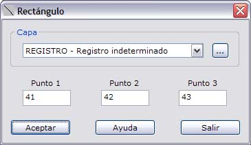

# Insertar rectángulo
<!-- id: insertar-rectangulo -->

Esta herramienta sirve para registrar entidades con forma de cuadrilátero en el fichero de croquis a partir de tres puntos de las esquinas. El programa muestra un cuadro de diálogo donde se deberán indicar estos tres puntos y el código o capa en el que se registrará la entidad.

Si en el listado de capas no se encontrara la capa deseada se puede pulsar el botón situado en la derecha para crear una capa nueva.

Si alguno de los puntos no existiera el programa mostrará un mensaje de error. Además, para registrar la entidad, el programa necesita calcular un punto adicional que se almacenará en un listado propio del croquis.

