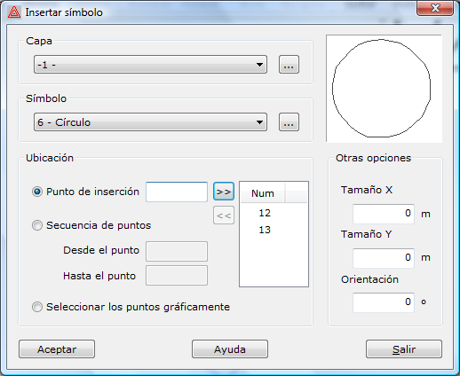

# Insertar símbolo
<!-- id: insertar-simbolo -->

Con esta herramienta se pueden incorporar símbolos puntuales al croquis ubicados en puntos que pertenecen a los ficheros de puntos relacionados con éste. Únicamente hay que indicar el número de símbolo, la capa donde se registrará y el número de punto de inserción.

Los campos presentados en el cuadro de diálogo son los siguientes:

* **Capa**: Se designará el nombre de la capa donde se registrará el símbolo. Se podrá elegir de la lista presentada o abrir el cuadro de diálogo [Lista de códigos de dibujo](../opciones-de-visualizacion/preferencias-de-dibujo/listado-de-codigos-de-dibujo.md) para crear un código de dibujo, pulsando el botón **…** que se encuentra a la derecha de la lista
* **Símbolo**: Se deberá elegir el símbolo que se desea insertar de la lista disponible. Si no estuviera el símbolo deseado, se puede acceder al cuadro de diálogo [Librería de símbolos](../opciones-de-visualizacion/preferencias-de-simbolizacion/libreria-de-simbolos.md) para crear un símbolo, pulsando el botón **…** que se encuentra a la derecha de la lista
* **Ubicación**: El lugar de inserción puede ser en un único punto o en una secuencia continuada de puntos. Elija el punto o la secuencia de puntos y pulse el botón **>>** para añadir los puntos a la lista de la derecha. De esta lista se puede quitar un punto pulsando el botón **&lt;&lt;**. El lugar de inserción no podrá ser modificado si se está modificando un símbolo existente. Las opciones para insertar son:
  * **Punto de inserción**: Se deberá designar el número del punto donde se desea insertar el símbolo.
  * **Secuencia de puntos**: Se deberá indicar los límites de la secuencia de puntos para insertar los puntos, insertándose todos los puntos entre estos límites.
  * **Seleccionar los puntos gráficamente**: Seleccionando esta opción, el programa vuelve a la pantalla del croquis para que se vayan seleccionando gráficamente aquellos puntos donde se quiere insertar el símbolo seleccionado en el cuadro de diálogo. Se podrá terminar la inserción de símbolos pulsando la tecla **ESC** o seleccionando otra herramienta o seleccionando la herramienta **Puntero**.
* **Otras opciones**:
  * **Tamaño X**: Tamaño del símbolo en X.
  * **Tamaño Y**: Tamaño del símbolo en Y.
  * **Orientación**: Orientación del símbolo.

