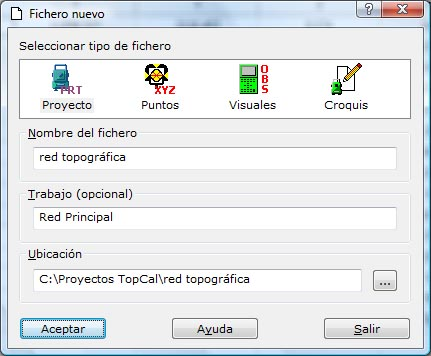
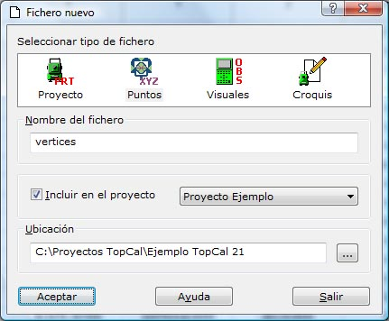
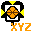
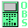
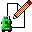

# Fichero nuevo
<!-- id: fichero-nuevo -->

Desde este cuadro de diálogo se puede crear un fichero nuevo, ya sea un proyecto, un fichero de puntos, un fichero de observaciones o un fichero de croquis. Se deberá seleccionar el tipo de fichero a crear en el listado de iconos que aparece en la parte superior del cuadro de diálogo. Los campos que se presentan son los siguientes:

* **Tipo de fichero**:
  * : [Proyecto](fichero-de-proyecto.md): Relaciona los diferentes archivos que componen un trabajo
  * : [Fichero de puntos](ficheros-de-puntos.md): Donde se almacenan los puntos tomados topográficamente
  * : [Fichero de observaciones](ficheros-de-visuales.md): Donde se almacenan las visuales observadas y almacenadas en la toma de datos
  * : [Fichero de croquis](fichero-de-croquis.md): Donde se almacenan las entidades geográficas generadas al unir puntos previamente almacenados en ficheros de puntos
* **Nombre del fichero**: Se indicará el nombre del fichero que creará el programa.
* **Nombre del trabajo**: Si se selecciona crear un proyecto nuevo, se indicará un texto explicativo del proyecto creado.
* **Incluir en el proyecto**: Si se selecciona crear un fichero de puntos, de observaciones o de croquis, se puede seleccionar añadir en alguno de los proyectos actualmente abiertos. Dichos proyectos están en la lista que aparece a su derecha. Si no se desea añadir a ningún proyecto se creará en la sección **Otros ficheros**.
* **Ubicación**: Se indicará la carpeta donde se va a crear el fichero. Si se selecciona crear un proyecto nuevo, el programa crea una carpeta nueva dentro de esta ubicación. Para elegir otra ubicación, pulse el botón **…** que se encuentra a la derecha.
