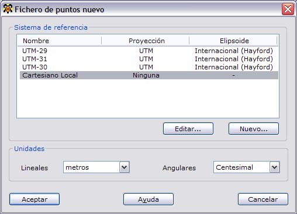

# Fichero de puntos
<!-- id: fichero-de-puntos -->

Este tipo de fichero almacena puntos cuyas coordenadas están referidas al sistema de coordenadas que se defina en la creación del fichero.

Estos puntos se definen por:

* **Número de punto**: Tiene que ser obligatoriamente numérico e identificará unívocamente al punto en cuestión. En otras palabras, es el campo que identifica un punto, por lo que el programa no permitirá que existan dos puntos con el mismo número. Si se pone este campo a cero, el programa interpretará que está borrado.
* **Coordenadas XYZ**: Serán las coordenadas introducidas manualmente o calculadas por el programa. Estos tres campos son numéricos y admiten decimales. Estarán referidas al sistema de coordenadas definido en el fichero.
* **Desorientación**: Será la desorientación angular introducida manualmente o calculada por el programa que se tenía en el teodolito en el momento de estacionar en dicho punto.
* **Nombre**: Nombre alfanumérico del punto.
* **Código**: Código registrado en campo perteneciente a la entidad geográfica a la que forma parte el punto. Para conocer qué códigos están registrados en la sesión de trabajo, consulte el cuadro de diálogo [Librería de códigos](../opciones-de-visualizacion/preferencias-de-croquizacion/lista-de-codigos-de-croquizacion.md).

Cuando se elige crear un fichero de puntos nuevo, la aplicación mostrará el siguiente cuadro de diálogo donde se podrá especificar el sistema de coordenadas a las que estarán referidas las coordenadas de los puntos:

En este cuadro de diálogo se deberán elegir los siguientes parámetros:

* **Sistema de referencia**: El sistema de referencia corresponderá a las coordenadas de los puntos y está formado por una proyección y un elipsoide de referencia. Se mostrarán los sistemas de referencia almacenados previamente en el programa y podrán ser editados o añadidos utilizando los botones situados en la parte inferior de la lista. Si se edita o añade algún sistema de referencia se muestra un cuadro de diálogo, explicado con detalle en [Sistema de referencia nuevo](../otros-comandos/sistemas-de-referencia/sistema-de-referencia-nuevo.md).
* **Unidades lineales**: Se elegirán las unidades en que estén almacenadas las coordenadas de los puntos. Se podrá optar entre metros y pies.
* **Unidades angulares**: Se elegirán las unidades en que estén almacenadas las desorientaciones de los puntos. Se podrá optar entre *centesimal*, *sexagesimal* y *sexagesimal pseudodecimal*.

Una vez elegidos y aceptados estos parámetros, se activa la ventana principal del programa correspondiente a la hoja de cálculo para empezar a editar el archivo de puntos. Los campos que se muestran son variables y es posible elegirlos. Para ello acuda al cuadro de diálogo de [Preferencias](../opciones-de-visualizacion/preferencias.md) en el menú [Editar](../menus-de-la-aplicacion/menu-editar.md).

Los archivos de puntos de TopCal 21 tienen, por defecto, extensión **PTS**.
