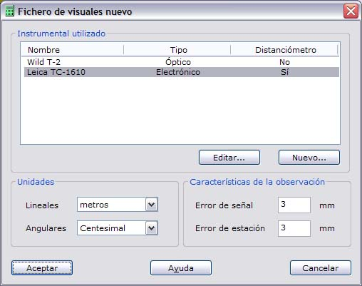

# Fichero de visuales
<!-- id: fichero-de-visuales -->

Este tipo de fichero almacena las visuales observadas con un instrumento topográfico en la toma de datos.

Las observaciones o visuales topográficas se definen por:

* **Número de estación**: Este campo identifica el punto estación donde se ubicó el instrumento topográfico en el momento de la toma de datos.
* **Número de visado**: Este campo identifica el punto que se ha visado con esta observación topográfica.
* **Horizontal**: Este campo identifica el valor del ángulo horizontal registrado en la toma de datos en las unidades angulares definidas en el fichero.
* **Vertical**: Este campo identifica el valor del ángulo vertical o cenital registrado en la toma de datos las unidades angulares definidas en el fichero.
* **Distancia**: Este campo identifica el valor de la distancia registrada en la toma de datos en las unidades lineales definidas en el fichero.
* **Mira**: Este campo identifica el valor de la altura de la mira o prisma en el momento de la toma de datos en las unidades lineales definidas en el fichero.
* **Instrumento**: Este campo identifica el valor de la altura del instrumento en el momento de la toma de datos en las unidades lineales definidas en el fichero.
* **Código**: Código registrado en campo perteneciente a la entidad geográfica a la que forma parte el punto visado.

Para realizar cálculos topográficos, el programa relaciona los ficheros de puntos y de observaciones mediante el campo **Número** del primero y los campos **Número de estación** y **Número de visado** del segundo. Por ejemplo, cuando se realiza una radiación desde una estación, esta estación deberá tener almacenadas las coordenadas en el fichero de puntos con un determinado número. Este número deberá coincidir con el campo **Estación** del archivo de observaciones. Después de realizados los cálculos, el programa guarda en el fichero de puntos tantos puntos como observaciones se realizaron, con el número que indique el campo **Visado** de dichas observaciones.

El programa permite tener almacenadas en el mismo archivo visuales entre la misma estación y el mismo visado, como por ejemplo, cuando se hacen repeticiones de visuales entre puntos para mejorar el cálculo, o cuando se hacen visuales en círculo directo e inverso para corregir las visuales de errores sistemáticos del instrumental utilizando la regla de Bessel. Para ello debe tener activada esta posibilidad en el cuadro de diálogo [Preferencias](../opciones-de-visualizacion/preferencias.md) del menú [Editar](../menus-de-la-aplicacion/menu-editar.md).

Cuando se elige crear un fichero de visuales nuevo, la aplicación mostrará el siguiente cuadro de diálogo donde se podrá especificar el instrumental topográfico utilizado y las condiciones de la observación:

En este cuadro de diálogo se deberán elegir los siguientes parámetros:

* **Instrumental utilizado**: El programa muestra un listado de los instrumentales topográficos almacenados, entre los que el usuario podrá elegir el utilizado. También podrá editar o añadir alguno nuevo, utilizando para ello los botones situados en la parte inferior de la lista. Si se edita o añade algún instrumental topográfico se muestra un cuadro de diálogo, explicado con detalle en [Instrumento topográfico nuevo](../otros-comandos/instrumentos-topograficos/instrumento-topografico-nuevo.md).
* **Unidades lineales**: Se elegirán las unidades en que estén registradas las distancias, alturas de mira y de instrumento. Se podrá optar entre metros y pies.
* **Unidades angulares**: Se elegirán las unidades en que estén almacenados los ángulos horizontales y verticales en las observaciones. Se podrá optar entre *centesimal*, *sexagesimal* y *sexagesimal pseudodecimal*.
* **Características de la observación**: Se le indicará al programa el error cometido en cada estacionamiento y en cada señalización de los puntos utilizados en las observaciones, en milímetros. Como referencia, puede introducir 5 mm para el error de estacionamiento y 5 mm para el error de señalización.

Una vez elegidos estos parámetros, se activa la ventana principal del programa correspondiente a la hoja de cálculo para empezar a editar el archivo de observaciones. Los campos que se muestran son variables y es posible elegirlos. Para ello acuda al cuadro de diálogo de [Preferencias](../opciones-de-visualizacion/preferencias.md) en el menú [Editar](../menus-de-la-aplicacion/menu-editar.md).

Los archivos de visuales de TopCal 21 tienen, por defecto, extensión **OBS**.
