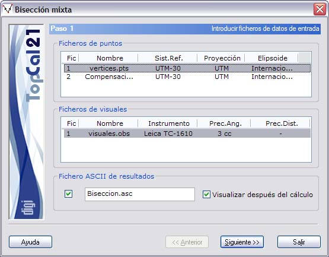

# Paso 1: Introducir ficheros de datos de entrada
<!-- id: topcal21-biseccion-mixta-paso-1-introducir-ficheros-de-datos-de-entrada -->

Este es el primer paso para calcular una bisección mixta. Los datos requeridos son los siguientes:

* **Ficheros de puntos**: Se seleccionarán los ficheros de puntos del proyecto que se desean utilizar en las intersecciones. Sólo se podrá continuar el cálculo si todos los ficheros de puntos seleccionados están referidos al mismo sistema de referencia.
* **Ficheros de visuales**: Se seleccionarán los ficheros de observaciones del proyecto que contienen las visuales utilizadas en el cálculo.
* **Ficheros de resultados**: Se escribirá el nombre del fichero de salida con los resultados del cálculo. Este archivo podrá ser del formato **html** o de formato **ASCII**. Si la extensión de este archivo es HTM o html se tomará como formato html y en caso contrario se tomará como formato ASCII. Este archivo se podrá visualizar (con el visor que se hubiese indicado en el cuadro de [Preferencias](../../opciones-de-visualizacion/preferencias.md) del menú [Editar](../../menus-de-la-aplicacion/menu-editar.md)) si se activa la casilla inferior denominada **Visualizar después del cálculo**. Si no se desea crear este archivo, se deberá desactivar la casilla que aparece a la izquierda del nombre. El archivo se creará en el directorio del proyecto.

Una vez introducidos estos datos se podrá pulsar el botón **Siguiente** para acceder al [Paso 2: Configurar cálculo y salida de datos](paso-2-configurar-calculo-y-salida-de-datos.md).
