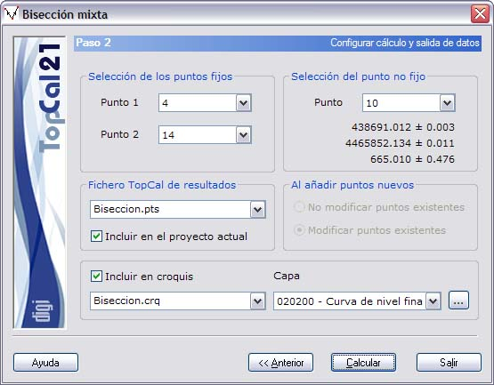

# Paso 2: Configurar cálculo y salida de datos
<!-- id: topcal21-biseccion-mixta-paso-2-configurar-calculo-y-salida-de-datos -->

Este es el segundo y último paso en el cálculo de una bisección mixta.

La pantalla permite seleccionar los puntos del cálculo y configurar los datos de salida, y muestra las coordenadas calculadas. Se muestran los siguientes campos:

* **Selección de los puntos fijos**: Se muestran dos listados donde se deberán elegir los puntos que se consideran dato en el cálculo. Estos puntos deberán tener almacenadas las coordenadas en los ficheros de puntos seleccionados en el paso anterior. Además, si se quiere calcular correctamente la cota del punto, es importante que estos puntos tengan cota. El orden en la selección no altera el cálculo.
* **Selección del punto no fijo**: Se muestra un listado donde se deberán elegir el punto del que se desea calcular las coordenadas. En este listado sólo se mostrarán aquellos puntos que al menos tengan visuales (con al menos una distancia) a los puntos fijos elegidos en los ficheros de visuales seleccionados en el paso anterior. Según se vayan seleccionado los puntos fijos, este listado irá cambiando añadiendo los puntos que cumplen esta condición. El orden en la selección no altera el cálculo.
* **Resultados**: Se muestran las coordenadas XYZ del punto considerado como no fijo más la diferencia encontrada entre los dos posibles caminos de resolución. Si no se ha podido calcular, se mostrará un mensaje con el error producido.
* **Fichero TopCal de resultados**: Se podrá seleccionar el nombre del fichero TopCal donde se almacenarán los puntos. Se podrá elegir alguno de los archivos existentes o generar un archivo nuevo. Si se desea generar un archivo nuevo, se podrá elegir añadir o no el fichero al proyecto actual.
* **Modo de añadir puntos**: Si el fichero de puntos no es nuevo se podrá elegir modificar o no los puntos con el mismo número que se encuentren en el fichero de salida elegido.
* **Croquis**: Se podrá seleccionar el nombre del fichero TopCal de croquis donde se registrará un gráfico con la intersección. Se podrá elegir alguno de los archivos existentes o generar un archivo nuevo. Además, se podrá indicar la **capa** en la que se registrarán las líneas del gráfico.

Una vez que se hayan configurado los datos de salida, se podrá terminar el proceso pulsando el botón **Calcular** o volver al paso anterior [Paso 1: Introducir ficheros de entrada](paso-1-introducir-ficheros-de-datos-de-entrada.md) pulsando el botón **Anterior**.
