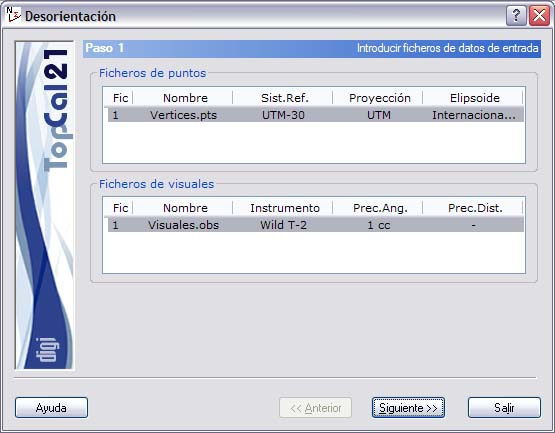

# Paso 1: Introducir ficheros de datos de entrada
<!-- id: topcal21-calculo-de-desorientaciones-paso-1-introducir-ficheros-de-datos-de-entrada -->

Este es el primer paso para calcular la desorientación de una estación. Los datos requeridos son los siguientes:

* **Ficheros de puntos**: Se seleccionarán los ficheros de puntos del proyecto que se desean utilizar en el cálculo de las desorientaciones. Sólo se podrá continuar el cálculo si todos los ficheros de puntos seleccionados están referidos al mismo sistema de referencia.
* **Ficheros de visuales**: Se seleccionarán los ficheros de observaciones del proyecto que contienen las visuales utilizadas en el cálculo.

Una vez introducidos estos datos se podrá pulsar el botón **Siguiente** para acceder al [Paso 2: Selección de la estación](paso-2-seleccion-de-la-estacion.md).
