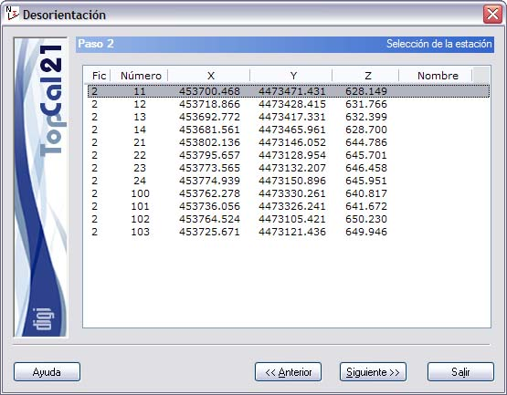

# Paso 2: Selección de la estación
<!-- id: topcal21-calculo-de-desorientaciones-paso-2-seleccion-de-la-estacion -->

En este segundo paso, se muestra una pantalla con los puntos con coordenadas almacenados en los ficheros de puntos seleccionados en el *Paso 1* y que actúen como estación en alguno de los ficheros de visuales seleccionados en el mismo paso. En esta lista se deberá seleccionar la estación de la cual se va a calcular su desorientación.

El listado que se muestra contiene los siguientes campos:

* **Índice de fichero**: Indica el índice del fichero de puntos donde se encuentra almacenado el punto
* **Número de punto**
* **Coordenadas del punto**
* **Nombre del punto**

Cuando se haya seleccionado la estación se puede pulsar al botón **Siguiente** para acceder al [Paso 3: Selección de visuales](paso-3-seleccion-de-visuales.md) o volver al [Paso 1: Introducir ficheros de datos de entrada](paso-1-introducir-ficheros-de-datos-de-entrada.md) pulsando el botón **Anterior**.
