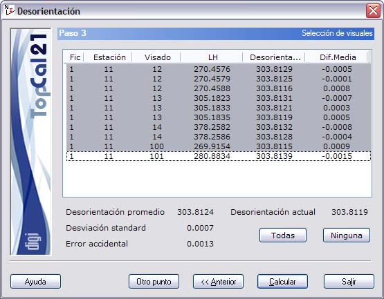

# Paso 3: Selección de visuales
<!-- id: topcal21-calculo-de-desorientaciones-paso-3-seleccion-de-visuales -->

En este último paso se muestra una pantalla con las visuales almacenadas en los ficheros de observaciones seleccionados en el *Paso 1*, cuya estación sea la seleccionada en el *Paso 2* y siempre y cuando los puntos visados tengas coordenadas almacenadas en los archivos de puntos seleccionados en el *Paso 1*.

El listado que se muestra contiene los siguientes campos:

* **Índice de fichero**: Indica el índice del fichero de observaciones donde se encuentra almacenada la visual.
* **Número de punto estación**
* **Número de punto visado**
* **Lectura horizontal**
* **Desorientación**: Desorientación calculada con esa lectura horizontal
* **Diferencia con la media**: Diferencia de la desorientación calculada con esa lectura y la media de todas las desorientaciones seleccionadas. Si la diferencia respecto de la media supera el error accidental acimutal, revise la visual y deselecciónela si decide excluirla del cálculo.

Se podrán seleccionar múltiples visuales utilizando la tecla *\[CTRL\]* y pulsando con el botón izquierdo del ratón sobre las visuales deseadas. Si se pulsa sobre una visual ya seleccionada, ésta se deselecciona.

También se pueden seleccionar visuales dispuestas en rangos, pulsando la tecla *\[MAYÚSCULAS\]* y el botón izquierdo del ratón sobre las visuales límite que definen el rango.

De la misma forma, se pueden utilizar los botones de **Todas** o **Ninguna** para seleccionar o deseleccionar todas las visuales.

En función de las visuales seleccionadas se calcularán simultáneamente la media de las desorientaciones, mostrándola en el campo **Desorientación promedio**. Además, se ofrece el valor de la **desorientación actual**, almacenada en el punto estación, la **desviación estándar** de toda la serie y el **error accidental** acimutal para valorar si los cálculos son idóneos. Si la desviación respecto de la media de alguno de los puntos es superior a este error accidental se debería proceder a deseleccionar dicha visual para mejorar el cálculo.

Una vez que se hayan configurado los datos de salida, se podrá terminar el proceso pulsando el botón **Calcular** o volver al paso anterior [Paso 2: Selección de la estación](paso-2-seleccion-de-la-estacion.md) pulsando el botón **Anterior**. También es posible salvar la desorientación para esta estación y volver a calcular la desorientación para otro punto pulsando el botón **Otro Punto**.
