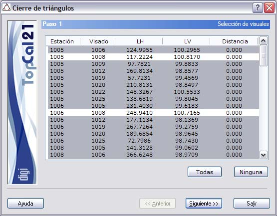

# Paso 1: Selección de visuales
<!-- id: topcal21-cierre-de-triangulos-paso-1-seleccion-de-visuales -->

Este es el primer paso para el cálculo de los cierres de triángulos formados por un conjunto de visuales. Se muestra un cuadro de diálogo con las visuales contenidas en el fichero, en el que se tendrán que seleccionar qué visuales se desean utilizar en el cálculo.

El listado que se muestra contiene los siguientes campos:

* **Número de punto estación**
* **Número de punto visado**
* **Lectura horizontal**
* **Lectura vertical**
* **Distancia**

Se podrán seleccionar múltiples visuales utilizando la tecla *\[CTRL\]* y pulsando con el botón izquierdo del ratón sobre las visuales deseadas. Si se pulsa sobre una visual ya seleccionada, ésta se deselecciona.

También se pueden seleccionar visuales dispuestas en rangos, pulsando la tecla *\[MAYÚSCULAS\]* y el botón izquierdo del ratón sobre las visuales límite que definen el rango.

De la misma forma, se pueden utilizar los botones de **Todas** o **Ninguna** para seleccionar o deseleccionar todas las visuales.

Una vez que se hayan seleccionado las visuales deseadas se podrá pasar al [Paso 2: Visuales repetidas y sin recíproca](paso-2-visuales-repetidas-y-sin-reciproca.md) pulsando el botón **Siguiente**.
