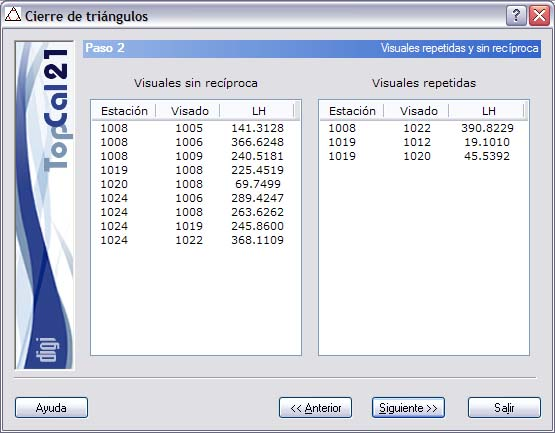

# Paso 2: Visuales repetidas y sin recíproca
<!-- id: topcal21-cierre-de-triangulos-paso-2-visuales-repetidas-y-sin-reciproca -->

El segundo paso del cierre de triángulos muestra un cuadro de diálogo informativo con las visuales sin recíproca y repetidas encontradas entre las que se seleccionaron en el paso anterior.

Si no se está conforme con los datos que se muestran se podrán volver al paso anterior [Paso 1: Selección de visuales](paso-1-seleccion-de-visuales.md), pulsando el botón **Anterior** o continuar con el cálculo pasando al [Paso 3: Cierres resultantes](paso-3-cierres-resultantes.md), pulsando el botón **Siguiente**.
