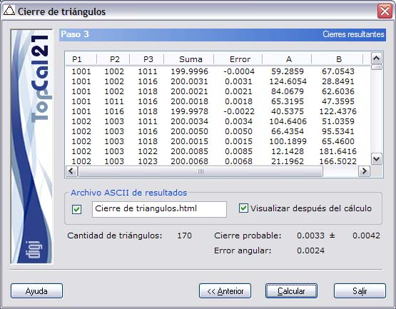

# Paso 3: Cierres resultantes
<!-- id: topcal21-cierre-de-triangulos-paso-3-cierres-resultantes -->

Este sería el último paso para el cálculo de cierre de triángulos en el que se muestra una relación de los triángulos formados y el cierre resultante de cada uno de ellos.

El listado que se muestra contiene los siguientes campos:

* **Punto 1**
* **Punto 2**
* **Punto 3**
* **Suma de los tres ángulos**
* **Error**, como diferencia de la suma menos 200 grados centesimales
* **Ángulo A**, formado por las visuales 1-2 y 1-3
* **Ángulo B**, formado por las visuales 2-1 y 2-3
* **Ángulo C**, formado por las visuales 3-1 y 3-2

El programa muestra la **cantidad de triángulos que ha podido cerrar** y el **cierre probable** de éstos, como media de todos ellos, así como la **desviación típica** de la serie. También se muestra el **error accidental** de cada triángulo para poder evaluar la bondad del cálculo.

Los resultados se pueden salvar en un fichero de salida. Este archivo podrá ser del formato **html** o de formato **ASCII**. Si la extensión de este archivo es HTM o html se tomará como formato html y en caso contrario se tomará como formato ASCII. Este archivo se podrá visualizar (con el visor que se hubiese indicado en el cuadro de [Preferencias](../../opciones-de-visualizacion/preferencias.md) del menú [Editar](../../menus-de-la-aplicacion/menu-editar.md)) si se activa la casilla inferior denominada **Visualizar después del cálculo**. Si no se desea crear este archivo, se deberá desactivar la casilla que aparece a la izquierda del nombre. El archivo se creará en el directorio del proyecto.

Una vez que se hayan configurado los datos de salida, se podrá terminar el proceso pulsando el botón **Calcular** o volver al paso anterior [Paso 2: Visuales repetidas y sin recíproca](paso-2-visuales-repetidas-y-sin-reciproca.md) pulsando el botón **Anterior**.
