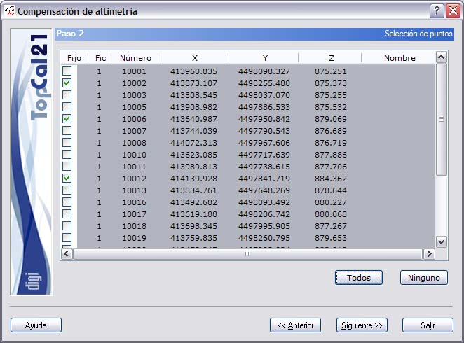

# Paso 2: Selección de puntos
<!-- id: topcal21-compensacion-de-altimetria-paso-2-seleccion-de-puntos -->

Este es el segundo paso para el cálculo de una compensación altimétrica.

Se muestra una pantalla con los puntos con coordenadas almacenados en los ficheros de puntos seleccionados en el *Paso 1* y los puntos que son visados desde estos puntos o que visan a estos puntos y cuyas visuales se encuentran en los ficheros de observaciones seleccionados en el *Paso 1*.

El listado que se muestra contiene los siguientes campos:

* **Casilla de fijo**: Esta casilla indica si el punto es fijo o no, en función de si está activada o no. Para activarla o desactivarla se deberá hacer doble click con el botón izquierdo del ratón sobre el punto deseado.
* **Índice de fichero**: Indica el índice del fichero de puntos donde se encuentra almacenado el punto. Si este campo es igual a 0 indicará que el punto no tiene actualmente coordenadas y que, por tanto, no está almacenado en ningún fichero, sino que existen visuales desde o hacia puntos de coordenadas conocidas.
* **Número de punto**
* **Coordenadas del punto**
* **Nombre del punto**

Se podrán seleccionar múltiples puntos utilizando la tecla *\[CTRL\]* y pulsando con el botón izquierdo del ratón sobre los puntos deseados. Si se pulsa sobre un punto ya seleccionado, éste se deselecciona.

También se pueden seleccionar puntos dispuestos en rangos, pulsando la tecla *\[MAYÚSCULAS\]* y el botón izquierdo del ratón sobre los puntos límite que definen el rango.

De la misma forma, se pueden utilizar los botones de **Todos** o **Ninguno** para seleccionar o deseleccionar todos los puntos.

Cuando se hayan seleccionado los puntos deseados se puede pulsar al botón **Siguiente** para acceder al [Paso 3: Selección de visuales](paso-3-seleccion-de-visuales.md) o volver al [Paso 1: Introducir ficheros de datos de entrada](paso-1-introducir-ficheros-de-datos-de-entrada.md) pulsando el botón **Anterior**.
