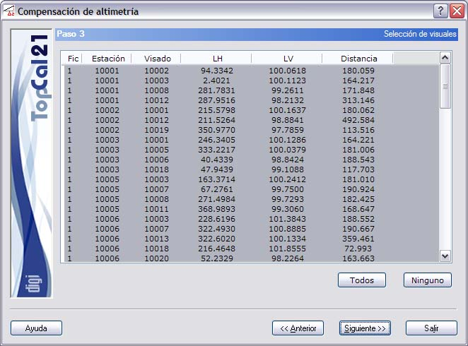

# Paso 3: Selección de visuales
<!-- id: topcal21-compensacion-de-altimetria-paso-3-seleccion-de-visuales -->

Este es el tercer paso para el cálculo de una compensación altimétrica.

Se muestra una pantalla con las visuales almacenadas en los ficheros de observaciones seleccionados en el *Paso 1* y en las que intervengan puntos seleccionados en el *Paso 2*.

El listado que se muestra contiene los siguientes campos:

* **Índice de fichero**: Indica el índice del fichero de observaciones donde se encuentra almacenada la visual.
* **Número de punto estación**
* **Número de punto visado**
* **Lectura horizontal**
* **Lectura vertical**
* **Distancia**

Se podrán seleccionar múltiples visuales utilizando la tecla *\[CTRL\]* y pulsando con el botón izquierdo del ratón sobre las visuales deseadas. Si se pulsa sobre una visual ya seleccionada, ésta se deselecciona.

También se pueden seleccionar visuales dispuestas en rangos, pulsando la tecla *\[MAYÚSCULAS\]* y el botón izquierdo del ratón sobre las visuales límite que definen el rango.

De la misma forma, se pueden utilizar los botones de **Todas** o **Ninguna** para seleccionar o deseleccionar todas las visuales.

Cuando se hayan seleccionado las visuales deseadas se puede pulsar al botón **Siguiente** para acceder al [Paso 4: Resultados y residuos generados](paso-4-resultados-y-residuos-generados.md) o volver al [Paso 2: Selección de puntos](paso-2-seleccion-de-puntos.md) pulsando el botón **Anterior**.
