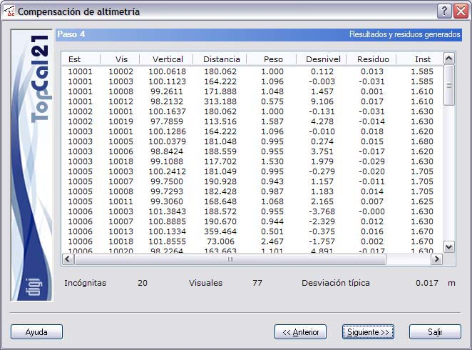

# Paso 4: Resultados y residuos generados
<!-- id: topcal21-compensacion-de-altimetria-paso-4-resultados-y-residuos-generados -->

Este es el cuarto paso para el cálculo de la compensación altimétrica.

Se muestra una pantalla con un listado con las diferentes visuales utilizadas en el cálculo. También se muestra el número de incógnitas y visuales utilizadas, así como la desviación típica de la serie.

Los campos ofrecidos son los siguientes:

* **Número de estación**
* **Número de punto visado**
* **Lectura vertical**
* **Distancia**
* **Peso**: Se da a la primera visual peso 1, y se van dando pesos proporcionales a la relación entre las distancias.
* **Desnivel**
* **Residuo**
* **Altura de instrumento**
* **Altura de mira**

Revise los residuos de las visuales, la **desviación típica a posteriori** del sistema y las exigencias de precisión del trabajo. Si decide descartar alguna visual, vuelva al paso anterior y deseleccione esa visual.

Este paso sólo es de información, no es necesario seleccionar nada. Por ello, se podrá acceder al siguiente paso [Paso 5: Configurar salida de datos](paso-5-configurar-salida-de-datos.md) pulsando el botón **Siguiente** o volver al paso anterior [Paso 3: Selección de visuales](paso-3-seleccion-de-visuales.md) para realizar algún cambio pulsando el botón **Anterior**.
