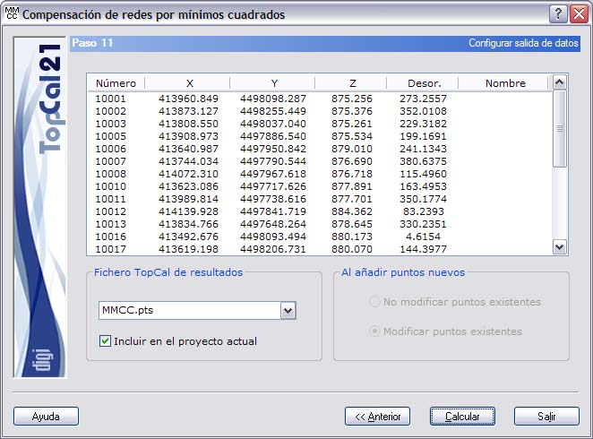

# Paso 11: Configurar salida de datos
<!-- id: topcal21-compensacion-por-minimos-cuadrados-paso-11-configurar-salida-de-datos -->

En este paso se muestra una pantalla con las coordenadas finales calculadas y la forma de salvar dichas coordenadas. Se muestran los siguientes campos:

* **Coordenadas finales**: Se muestra un listado con los puntos nuevos calculados, sus coordenadas y su desorientación.
* **Fichero TopCal de resultados**: Se podrá seleccionar el nombre del fichero TopCal donde se almacenarán los puntos. Se podrá elegir alguno de los archivos existentes o generar un archivo nuevo. Si se desea generar un archivo nuevo, se podrá elegir añadir o no el fichero al proyecto actual.
* **Modo de añadir puntos**: Si el fichero de puntos no es nuevo se podrá elegir modificar o no los puntos con el mismo número que se encuentren en el fichero de salida elegido.

Una vez que se hayan configurado los datos de salida, se puede pulsar al botón **Siguiente** para acceder al [Paso 12: Configurar croquis de dibujo](paso-12-configurar-croquis-de-dibujo.md) o volver al paso anterior pulsando el botón **Anterior**. Este paso depende del tipo de ajuste elegido:

* Si se seleccionó un ajuste altimétrico, el paso anterior será el [Paso 10: Resultados del test de Baarda altimétrico](paso-10-resultados-del-test-de-baarda-altimetrico.md).
* Si no se seleccionó un ajuste altimétrico, el paso anterior será el [Paso 7: Resultados del test de Baarda planimétrico](paso-7-resultados-del-test-de-baarda-planimetrico.md).
