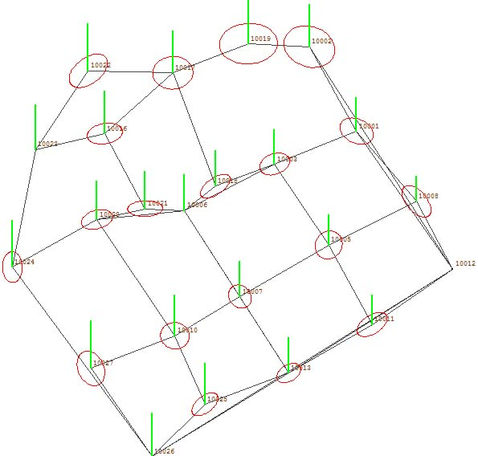
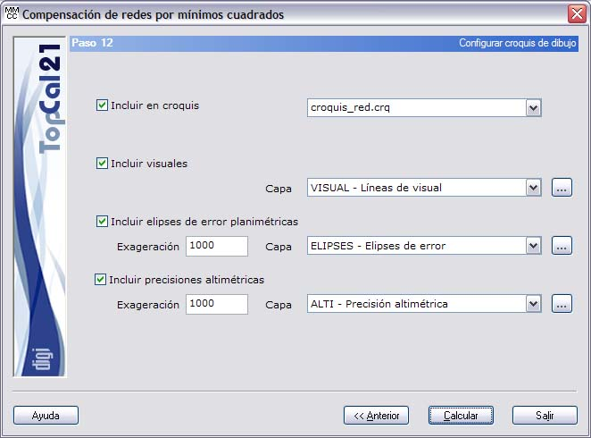

# Paso 12: Configurar croquis de dibujo
<!-- id: topcal21-compensacion-por-minimos-cuadrados-paso-12-configurar-croquis-de-dibujo -->

Este es el último paso en el cálculo del ajuste de una red y está dedicado a la generación de un fichero de croquis con las visuales utilizadas en el cálculo y las precisiones alcanzadas. El croquis representa la precisión de cada punto mediante elipses de error planimétricas y líneas de precisión altimétrica, según las opciones seleccionadas.

Los campos que se muestran son los siguientes:

* **Incluir en croquis**: Se deberá marcar esta casilla si se desea generar el croquis con la red ajustada. Si se activa se activarán el resto de campos, incluyendo el que aparece a la derecha donde se deberá indicar el nombre del croquis nuevo o elegir uno de los existentes en el proyecto.
* **Incluir visuales**: Si se ha elegido generar el croquis, se podrá elegir generar líneas por cada visual que ha participado en el cálculo. Si se activa esta casilla, se activará el campo que aparece a la derecha para elegir la **capa** en la que se registrarán dichas líneas. Si en el listado no se encuentra la capa deseada se puede pulsar el botón que aparece a la derecha para crear una capa nueva.
* **Incluir elipses de error planimétricas**: Si se ha elegido generar el croquis y se hizo un ajuste en planimetría, se podrá elegir generar elipses con la precisión planimétrica en cada punto que ha participado en el cálculo. Si se activa esta casilla, se activará el campo que aparece a la derecha para elegir la **capa** en la que se registrarán dichas elipses. Si en el listado no se encuentra la capa deseada se puede pulsar el botón que aparece a la derecha para crear una capa nueva. Asimismo, se activará el campo **exageración**, que establece el factor por el que se multiplica el tamaño con el que se dibujan las elipses de error. Esta exageración podrá ser cambiada posteriormente en las [Propiedades del croquis](../../opciones-de-visualizacion/propiedades-de-los-objetos/propiedades-del-archivo-de-croquis.md).
* **Incluir precisiones altimétricas**: Si se ha elegido generar el croquis y se hizo un ajuste en altimetría, se podrá elegir generar líneas verticales con la precisión altimétrica en cada punto que ha participado en el cálculo. Si se activa esta casilla, se activará el campo que aparece a la derecha para elegir la **capa** en la que se registrarán dichas líneas. Si en el listado no se encuentra la capa deseada se puede pulsar el botón que aparece a la derecha para crear una capa nueva. Asimismo, se activará el campo **exageración**, que establece el factor por el que se multiplica la longitud con la que se dibujan las líneas de precisión altimétrica. Esta exageración podrá ser cambiada posteriormente en las [Propiedades del croquis](../../opciones-de-visualizacion/propiedades-de-los-objetos/propiedades-del-archivo-de-croquis.md).

Una vez que se hayan configurado los datos de salida, se podrá terminar el proceso pulsando el botón **Calcular** o volver al [Paso 11: Configurar salida de datos](paso-11-configurar-salida-de-datos.md) pulsando el botón **Anterior**.
