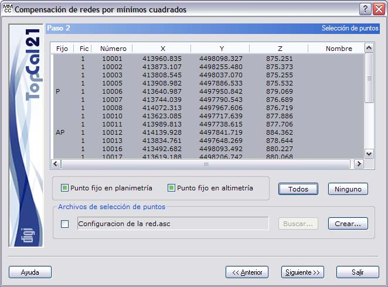

# Paso 2: Selección de puntos
<!-- id: topcal21-compensacion-por-minimos-cuadrados-paso-2-seleccion-de-puntos -->

Este es el segundo paso del cálculo. Se muestra una pantalla con los puntos con coordenadas almacenados en los ficheros de puntos seleccionados en el *Paso 1*. Como se ha comentado anteriormente, es necesario que los puntos dispongan de unas coordenadas aproximadas para poder ser ajustadas. Para poder calcular estas coordenadas se deberían utilizar el resto de herramientas de cálculo que posee el programa.

El listado que se muestra contiene los siguientes campos:

* **Casilla de fijo**: Esta casilla indica si el punto es fijo o no tanto en planimetría como en altimetría. Si el punto es fijo en planimetría aparecerá una letra *P*, y si es fijo en altimetría aparecerá una letra *A*. Para poder asignar estas características a los puntos, seleccione los puntos deseados y active o desactive las casillas situadas en la parte inferior del listado: **Punto fijo en planimetría** o **Punto fijo en altimetría**.
* **Índice de fichero**: Indica el índice del fichero de puntos donde se encuentra almacenado el punto.
* **Número de punto**
* **Coordenadas del punto**
* **Nombre del punto**

Se podrán seleccionar múltiples puntos utilizando la tecla *CTRL* y pulsando con el botón izquierdo del ratón sobre los puntos deseados. Si se pulsa sobre un punto ya seleccionado, éste se deselecciona.

También se pueden seleccionar puntos dispuestos en rangos, pulsando la tecla *MAYÚSCULAS* y el botón izquierdo del ratón sobre los puntos límite que definen el rango.

De la misma forma, se pueden utilizar los botones de **Todos** o **Ninguno** para seleccionar o deseleccionar todos los puntos.

También es posible cargar la información de la red a partir de un fichero ASCII de configuración de la red activando la casilla situada a la izquierda del nombre del archivo y pulsando el botón **Buscar** para desplegar el Explorador de Windows.

Además, si es la primera vez que se configura la red, se pueden seleccionar los puntos manualmente y crear el archivo de configuración para ser utilizado en posteriores ocasiones pulsando el botón **Crear**. El programa mostrará el Explorador de Windows para guardar el archivo; se recomienda guardarlo en la carpeta del proyecto, junto con los demás archivos del proyecto.

Para realizar una compensación altimétrica, únicamente es necesario que haya un punto fijo, pudiendo haber más.

Para realizar una compensación planimétrica, se tienen dos posibilidades:

* Que existan dos puntos fijos o más, estableciendo lo que se denomina *base de la red*. En este supuesto, es posible determinar la variable factor de escala para detectar posibles errores en la transmisión del factor de escala a la red. Para ello, se deben de disponer dos maneras de transmitir escala, siendo las posibilidades:
  * Más de dos puntos fijos.
  * Dos puntos fijos y medidas de distancias.
* Que exista un único punto fijo, denominándose, entonces, *red libre*. En este supuesto, es imprescindible la medida de distancias para transmitir escala a la red y, además, indicar una dirección que se mantendrá fija en el ajuste. El momento de indicarle esta dirección al programa será posterior al *Paso 5*.

Cuando se hayan seleccionado los puntos deseados se puede pulsar al botón **Siguiente** para acceder al [Paso 3: Configuración de la red y listados de salida](paso-3-configuracion-de-la-red-y-listados-de-salida.md) o volver al [Paso 1: Introducir ficheros de datos de entrada](paso-1-introducir-ficheros-de-datos-de-entrada.md) pulsando el botón **Anterior**.
