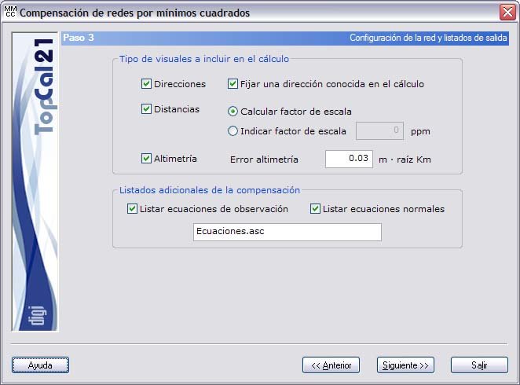

# Paso 3: Configuración de la red y listados de salida
<!-- id: topcal21-compensacion-por-minimos-cuadrados-paso-3-configuracion-de-la-red-y-listados-de-salida -->

El tercer paso del cálculo es la selección del tipo de visuales que van a intervenir en el cálculo y los listados adicionales que se desean del citado cálculo.

Para realizar una compensación planimétrica se pueden utilizar dos tipos de ecuaciones: de **dirección** y de **distancia**. Si para el cálculo de una red se han medido únicamente ángulos horizontales, la red es denominada *Triangulación*. Si solamente se han medido distancias, es denominada *Trilateración*. Y si se han medido ambas, *Triangulateración*.

Existe la posibilidad de **fijar direcciones conocidas en cálculo**. Esta opción permite al usuario introducir acimutes entre puntos conocidos con exactitud, por ejemplo, si se ha medido con un giróscopo.

Si, como se ha comentado antes, se han medido distancias y se dispone de dos puntos fijos o más, se está en disposición de calcular la diferencia de escala en la transmisión de ésta por medio de los dos métodos: la base y el distanciómetro.

Si la red es libre, es imprescindible seleccionar las distancias para dar escala a la red.

La red también puede ser ajustada en altimetría y para ello habrá que seleccionar dichas ecuaciones. El cálculo altimétrico está separado del planimétrico por no haber prácticamente correlación entre las coordenadas XY y la Z.

Si se selecciona un ajuste altimétrico habrá que indicarle al programa el **error kilométrico** asociado con las visuales para ponderarlas. Este valor puede ser calculado con la herramienta de [Cálculo de errores accidentales](../../calculos/calculo-de-errores-accidentales/README.md).

Por último, es posible listar, en formato ASCII, las ecuaciones que ha formado el programa y las diversas matrices utilizadas para su resolución, almacenándose en el archivo indicado a tal efecto.

Cuando se hayan seleccionado las opciones pertinentes se puede pulsar al botón **Siguiente** para acceder al [Paso 4: Selección de visuales](paso-4-seleccion-de-visuales.md) o volver al [Paso 2: Selección de puntos](paso-2-seleccion-de-puntos.md) pulsando el botón **Anterior**.
