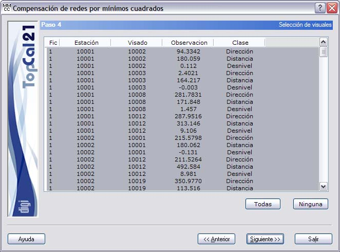

# Paso 4: Selección de visuales
<!-- id: topcal21-compensacion-por-minimos-cuadrados-paso-4-seleccion-de-visuales -->

El cuarto paso en el ajuste de la red es la selección de las visuales que formarán el cálculo.

El programa muestra un listado con las visuales de los ficheros seleccionados en el *Paso 1*, diferenciándolas por su naturaleza. Así, se tendrán visuales de *Dirección*, *Distancia* o *Desnivel*, con sus respectivas lecturas.

Esta manera de presentar los datos permitirá al usuario deseleccionar la visual que no desee que entre en el cálculo en función de los resultados posteriores, pero de manera individualizada, de tal manera, que, por ejemplo, se podrá seleccionar la observación de distancia a un determinado punto pero no su observación angular.

Además, se muestra la casilla **Comprobar a posteriori las visuales no seleccionadas**. Al activarla, el programa calcula el error de las observaciones que no se han seleccionado en este listado utilizando las coordenadas ajustadas, y escribe el listado con esos errores en el archivo de salida, a continuación del test de fiabilidad.

Cuando se hayan seleccionado las visuales deseadas se puede pulsar al botón **Siguiente** para acceder al siguiente paso. El siguiente paso dependerá del tipo de ajuste elegido:

* Si se seleccionó un ajuste planimétrico, el siguiente paso será el [Paso 5: Pesos y residuos de las observaciones planimétricas](paso-5-pesos-y-residuos-de-las-observaciones-planimetricas.md).
* Si no se seleccionó un ajuste planimétrico, el siguiente paso será el [Paso 8: Pesos y residuos de las observaciones altimétricas](paso-8-pesos-y-residuos-de-las-observaciones-altimetricas.md).

También puede volver al [Paso 3: Configuración de la red y listados de salida](paso-3-configuracion-de-la-red-y-listados-de-salida.md) pulsando el botón **Anterior**.
