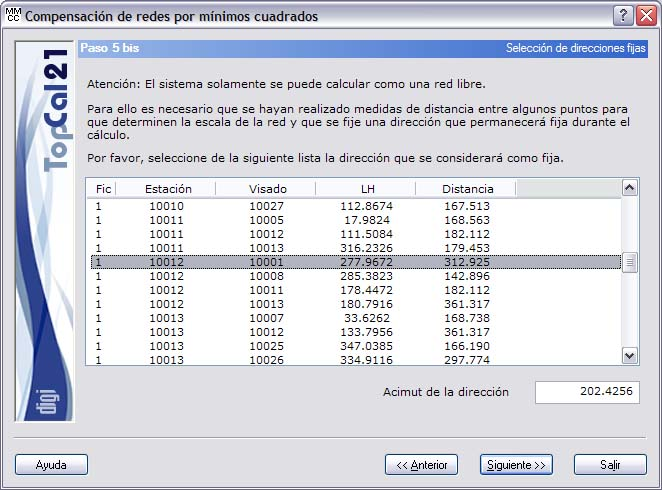

# Paso 5 bis: Selección de direcciones fijas en una red libre
<!-- id: topcal21-compensacion-por-minimos-cuadrados-paso-5-bis-seleccion-de-direcciones-fijas-en-una-red-libre -->

Si la red que se está ajustando es una red libre, en el siguiente paso del ajuste se deberá seleccionar la dirección que va a permanecer fija en el ajuste.

Esto se debe a que los datos de la red no permiten deducir su orientación, por lo que el usuario deberá determinar una dirección y su acimut. Conviene elegir una dirección con error accidental pequeño; para ello se suele elegir una visual a un punto alejado de la estación, porque así el error de dirección es menor y el punto visado se puede identificar sin ambigüedad.

Cuando se hayan seleccionado las opciones pertinentes se puede pulsar al botón **Siguiente** para acceder al [Paso 6: Desplazamientos y precisiones planimétricas](paso-6-desplazamientos-y-precisiones-planimetricas.md) o volver al [Paso 5: Pesos y residuos de las observaciones planimétricas](paso-5-pesos-y-residuos-de-las-observaciones-planimetricas.md) pulsando el botón **Anterior**.
