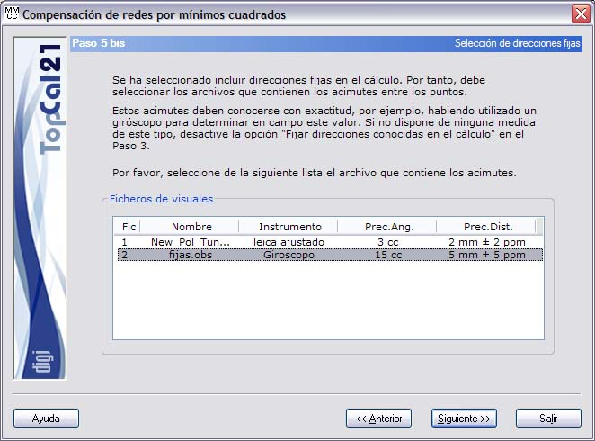

# Paso 5 bis: Selección de direcciones fijas
<!-- id: topcal21-compensacion-por-minimos-cuadrados-paso-5-bis-seleccion-de-direcciones-fijas -->

Si se seleccionó introducir direcciones fijas, en el siguiente paso del ajuste se deberá seleccionar el archivo que contiene dichas direcciones, que permanecerán fijas durante el ajuste.

Esta opción está disponible para introducir aquellas direcciones de las que se conoce su acimut sin cálculo previo, por ejemplo, porque se ha utilizado un giróscopo. El programa mantendrá el acimut de estas direcciones y modificará las demás visuales.

Cuando se hayan seleccionado las opciones pertinentes se puede pulsar al botón **Siguiente** para acceder al [Paso 6: Desplazamientos y precisiones planimétricas](paso-6-desplazamientos-y-precisiones-planimetricas.md) o volver al [Paso 5: Pesos y residuos de las observaciones planimétricas](paso-5-pesos-y-residuos-de-las-observaciones-planimetricas.md) pulsando el botón **Anterior**.
