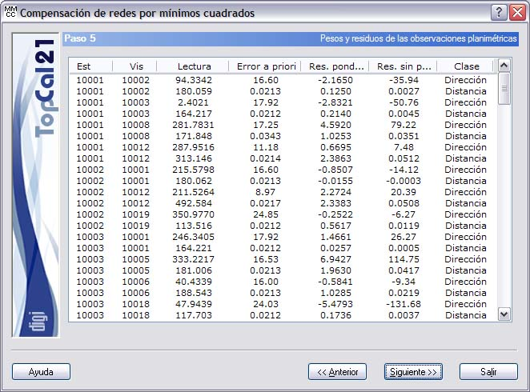

# Paso 5: Pesos y residuos de las observaciones planimétricas
<!-- id: topcal21-compensacion-por-minimos-cuadrados-paso-5-pesos-y-residuos-de-las-observaciones-planimetricas -->

En el siguiente paso del ajuste, el programa analiza a priori las observaciones planimétricas que van a entrar en el cálculo, mostrando un listado con los siguientes datos:

* **Estación**
* **Visado**
* **Lectura**: Las unidades de este campo variarán dependiendo de la clase de la visual: grados centesimales para los ángulos y metros para las distancias.
* **Error a priori**: Este error es el error accidental que tiene esta visual y depende de la distancia de observación, del tipo de instrumental y de las condiciones de estacionamiento y señalización. Al igual que antes las unidades variarán dependiendo de la clase de la visual: segundos centesimales para los ángulos y metros para las distancias.
* **Residuo ponderado**: Este valor adimensional es el resultado de dividir el residuo sin ponderar por el error a priori que tiene la visual.
* **Residuo sin ponderar**: Este valor es la diferencia entre el valor observado (la propia visual) y el valor calculado con las coordenadas aproximadas de los puntos. La diferencia puede deberse a errores de observación o de las coordenadas aproximadas. Al igual que antes, las unidades variarán dependiendo de la clase de la visual: segundos centesimales para los ángulos y metros para las distancias.
* **Clase**: La clase de las observaciones planimétricas podrá ser *Dirección* o *Distancia*.

Pulsando sobre la cabecera de este listado es posible ordenar de forma ascendente o descendente según la columna pulsada.

Este paso sólo es de información, no es necesario seleccionar nada. Por ello, se puede pulsar al botón **Siguiente** para acceder al siguiente paso. El siguiente paso dependerá del tipo de red que se está ajustando:

* Si se trata de una red libre o si se ha seleccionado introducir una dirección fija, el siguiente paso será el [Paso 5 bis: Selección de direcciones fijas](paso-5-bis-seleccion-de-direcciones-fijas-en-red-libre.md).
* Si se trata de una red normal, el siguiente paso será el [Paso 6: Desplazamientos y precisiones planimétricas](paso-6-desplazamientos-y-precisiones-planimetricas.md).

También puede volver al [Paso 4: Selección de visuales](paso-4-seleccion-de-visuales.md) pulsando el botón **Anterior**.
