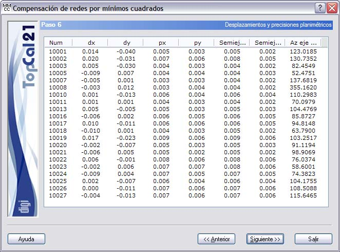

# Paso 6: Desplazamientos y precisiones planimétricas
<!-- id: topcal21-compensacion-por-minimos-cuadrados-paso-6-desplazamientos-y-precisiones-planimetricas -->

Con los puntos, las visuales y las características de la red seleccionados, el programa ajusta la red y muestra en este paso el resultado: los desplazamientos de las coordenadas de los puntos no fijos y sus precisiones.

Los desplazamientos dependen de la diferencia entre las coordenadas aproximadas y las coordenadas obtenidas en el ajuste. Sin embargo, el valor de estas coordenadas aproximadas no influirá en el valor de las precisiones alcanzadas.

Estos resultados se muestran en un listado, donde cada línea corresponde a un punto no fijo y cuyos campos son los siguientes:

* **Número del punto**
* **Desplazamiento en X**: Este es el desplazamiento que sufre la coordenada X aproximada del punto después del ajuste en metros.
* **Desplazamiento en Y**: Este es el desplazamiento que sufre la coordenada Y aproximada del punto después del ajuste en metros.
* **Precisión en X**: Esta es la precisión alcanzada para la coordenada X en metros.
* **Precisión en Y**: Esta es la precisión alcanzada para la coordenada Y en metros.
* **Semieje mayor** de la elipse de error en metros
* **Semieje menor** de la elipse de error en metros
* **Acimut del semieje mayor** de la elipse de error en grados centesimales.

Si por falta de redundancia no se ha podido calcular la precisión de un punto, aparecerá el carácter “?” en los campos relativos a esta. Pulsando sobre la cabecera de este listado es posible ordenar de forma ascendente o descendente según la columna pulsada.

Cuando se hayan seleccionado las opciones pertinentes se puede pulsar al botón **Siguiente** para acceder al [Paso 7: Resultados del test de Baarda planimétrico](paso-7-resultados-del-test-de-baarda-planimetrico.md).

También se puede volver al paso anterior pulsado el botón **Anterior**. Este paso depende del tipo de red que se está ajustando:

* Si se trata de una red libre, el paso anterior será el [Paso 5 bis: Selección de direcciones fijas](paso-5-bis-seleccion-de-direcciones-fijas-en-red-libre.md).
* Si se trata de una red normal, el paso anterior será el [Paso 5: Pesos y residuos de las observaciones planimétricas](paso-5-pesos-y-residuos-de-las-observaciones-planimetricas.md).
