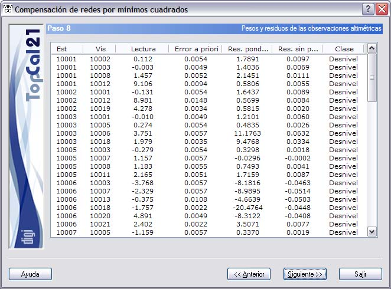

# Paso 8: Pesos y residuos de las observaciones altimétricas
<!-- id: topcal21-compensacion-por-minimos-cuadrados-paso-8-pesos-y-residuos-de-las-observaciones-altimetricas -->

En el siguiente paso del ajuste, el programa analiza a priori las observaciones altimétricas que van a entrar en el cálculo, mostrando un listado con los siguientes datos:

* **Estación**
* **Visado**
* **Lectura**: Desniveles calculados en metros.
* **Error a priori**: Este error es el error accidental que tiene esta visual y depende de la distancia de observación, del tipo de instrumental y de las condiciones de estacionamiento y señalización. Viene expresado en metros.
* **Residuo ponderado**: Este valor adimensional es el resultado de dividir el residuo sin ponderar por el error a priori que tiene la visual.
* **Residuo sin ponderar**: Este valor es la diferencia entre el desnivel observado (la propia visual) y el desnivel calculado con las coordenadas aproximadas de los puntos. La diferencia puede deberse a errores de observación o de las coordenadas aproximadas. Viene expresado en metros.
* **Clase**: La clase de las observaciones altimétricas siempre será de *Desnivel*.

Pulsando sobre la cabecera de este listado es posible ordenar de forma ascendente o descendente según la columna pulsada.

Este paso sólo es de información, no es necesario seleccionar nada. Por ello, se puede pulsar al botón **Siguiente** para acceder al [Paso 9: Desplazamientos y precisiones altimétricas](paso-9-desplazamientos-y-precisiones-altimetricas.md).

También se puede volver al paso anterior pulsado el botón **Anterior**. Este paso depende del tipo de ajuste elegido:

* Si se seleccionó un ajuste planimétrico, el paso anterior será el [Paso 7: Resultados del test de Baarda planimétrico](paso-7-resultados-del-test-de-baarda-planimetrico.md).
* Si no se seleccionó un ajuste planimétrico, el paso anterior será el [Paso 4: Selección de visuales](paso-4-seleccion-de-visuales.md).
