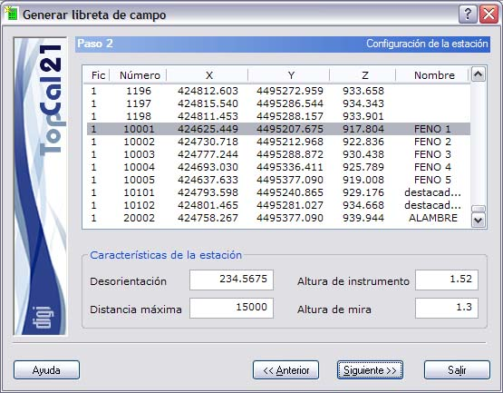

# Paso 2: Configuración de la estación
<!-- id: topcal21-generar-libreta-de-campo-paso-2-configuracion-de-la-estacion -->

Este es el segundo paso para generar la libreta de campo.

Se muestra una pantalla con los puntos con coordenadas almacenados en los ficheros de puntos seleccionados en el *Paso 1*. Se deberán seleccionar únicamente un punto estación desde donde se generarán las visuales correspondientes.

El listado que se muestra contiene los siguientes campos:

* **Índice de fichero**: Indica el índice del fichero de puntos donde se encuentra almacenado el punto.
* **Número de punto**
* **Coordenadas del punto**
* **Nombre del punto**

Una vez seleccionado el punto estación, se deberán indicar las siguientes características del estacionamiento:

* **Desorientación**
* **Distancia máxima de radiación de los puntos**
* **Altura de instrumento**
* **Altura de prisma**

Cuando se haya seleccionado la estación se puede pulsar al botón **Siguiente** para acceder al [Paso 3: Selección de los puntos visados](paso-3-seleccion-de-los-puntos-visados.md) o volver al [Paso 1: Introducir ficheros de datos de entrada](paso-1-introducir-ficheros-de-datos-de-entrada.md) pulsando el botón **Anterior**.
