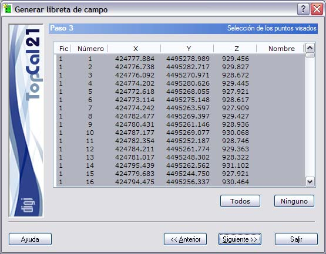

# Paso 3: Selección de los puntos visados
<!-- id: topcal21-generar-libreta-de-campo-paso-3-seleccion-de-los-puntos-visados -->

Este es el tercer paso para generar la libreta de campo.

Se muestra una pantalla con los puntos almacenados en los ficheros seleccionados en el *Paso 1* y que no sea la estación seleccionada en el *Paso 2*. En este paso se deberán seleccionar con qué puntos se quieren generar las visuales.

El listado que se muestra contiene los siguientes campos:

* **Índice de fichero**: Indica el índice del fichero de puntos donde se encuentra almacenado el punto.
* **Número de punto**
* **Coordenadas del punto**
* **Nombre del punto**

Se podrán seleccionar múltiples puntos utilizando la tecla *\[CTRL\]* y pulsando con el botón izquierdo del ratón sobre los puntos deseados. Si se pulsa sobre un punto ya seleccionado, éste se deselecciona.

También se pueden seleccionar puntos dispuestos en rangos, pulsando la tecla *\[MAYÚSCULAS\]* y el botón izquierdo del ratón sobre los puntos límite que definen el rango.

De la misma forma, se pueden utilizar los botones de **Todos** o **Ninguno** para seleccionar o deseleccionar todos los puntos.

Cuando se hayan seleccionado los puntos deseados se puede pulsar al botón **Siguiente** para acceder al [Paso 4: Configurar salida de datos](paso-4-configurar-salida-de-datos.md) o volver al [Paso 2: Configuración de la estación](paso-2-configuracion-de-la-estacion.md) pulsando el botón **Anterior**.
