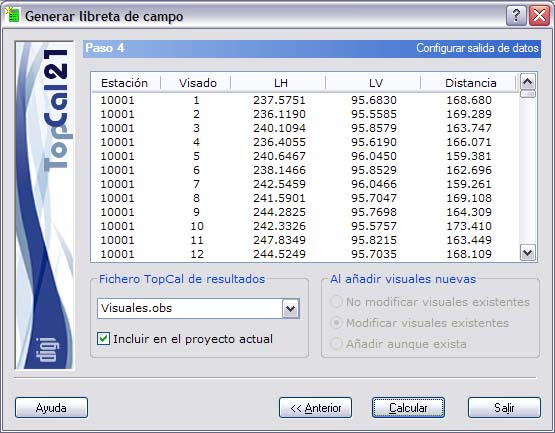

# Paso 4: Configurar salida de datos
<!-- id: topcal21-generar-libreta-de-campo-paso-4-configurar-salida-de-datos -->

Este es el cuarto y último paso para la generación de la libreta de campo.

Se muestran los siguientes campos:

* **Listado con las visuales generadas**: Donde se indica el número de estación, número de punto visado, lectura horizontal, lectura vertical y distancia geométrica.
* **Fichero TopCal de resultados**: Se podrá seleccionar el nombre del fichero TopCal donde se almacenarán las visuales. Se podrá elegir alguno de los archivos existentes o generar un archivo nuevo. Si se desea generar un archivo nuevo, se podrá elegir añadir o no el fichero al proyecto actual.
* **Modo de añadir visuales**: Si el fichero de visuales no es nuevo se podrá elegir modificar o no las visuales con la misma estación y mismo visado que se encuentren en el fichero de salida elegido o añadir las visuales aunque existan con la misma estación y el mismo punto visado.

Una vez que se hayan configurado los datos de salida, se podrá terminar el proceso pulsando el botón **Calcular** o volver al paso anterior [Paso 3: Selección de los puntos visados](paso-3-seleccion-de-los-puntos-visados.md) pulsando el botón **Anterior**.
