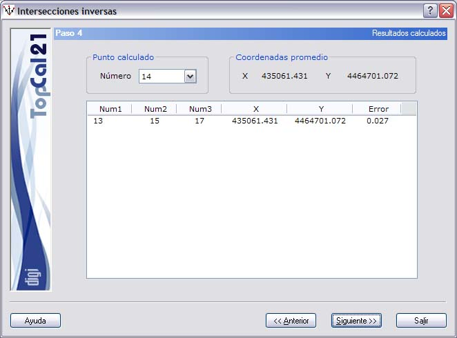

# Paso 4: Resultados calculados
<!-- id: topcal21-intersecciones-inversas-paso-4-resultados-calculados -->

Este es el cuarto paso para el cálculo de las intersecciones inversas.

Se muestra una pantalla donde se muestra cada uno de los puntos calculados, cuyas coordenadas son el resultado de promediar las diferentes intersecciones inversas simples que se han podido formar. Estas coordenadas aparecen en la parte superior derecha del cuadro de diálogo.

En la parte central, se muestra un listado con las intersecciones inversas simples realizadas desde punto y el semieje mayor de la elipse de error calculado a partir del instrumental y de las condiciones de cada intersección. Pulsando sobre la cabecera de este listado es posible ordenar de forma ascendente o descendente según la columna pulsada.

Las coordenadas promedio serán utilizadas como coordenadas aproximadas para proceder con un cálculo mínimo cuadrático cuyos resultados se muestran en el paso siguiente.

Este paso sólo es de información, no es necesario seleccionar nada. Por ello, se podrá acceder al siguiente paso [Paso 5: Residuos generados](paso-5-residuos-generados.md) pulsando el botón **Siguiente** o volver al paso anterior [Paso 3: Selección de visuales](paso-3-seleccion-de-visuales.md) para realizar algún cambio pulsando el botón **Anterior**.
