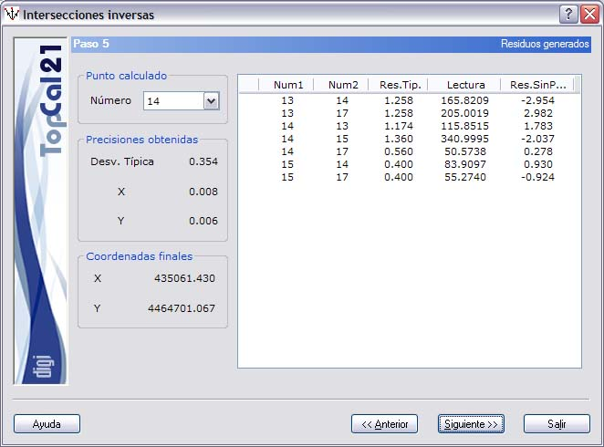

# Paso 5: Residuos generados
<!-- id: topcal21-intersecciones-inversas-paso-5-residuos-generados -->

Este es el quinto paso para el cálculo de las intersecciones inversas.

Se muestra una pantalla donde se muestran los puntos calculados, y las visuales utilizadas para el cálculo por mínimos cuadrados. Los campos ofrecidos son los siguientes:

* **Punto calculado**: Se ofrece una lista con los diferentes puntos calculados.
* **Visuales**: Se muestra una lista con las diferentes visuales, directas e inversas, que podrían intervenir en el cálculo mínimo cuadrático de las coordenadas del punto. Se muestran los puntos estación y visado de la visual y el residuo tipificado de la visual. Para más información acerca del residuo tipificado consulte [Paso 7 de la Compensación por Mínimos Cuadrados](../compensacion-por-minimos-cuadrados/paso-7-resultados-del-test-de-baarda-planimetrico.md). Si el residuo es mayor que el valor crítico 3.29, se señalará con una marca (\*). Si no se pudo comprobar la bondad de la observación, aparecerá el carácter “?”. Si la visual está marcada no debería ser utilizada para calcular las coordenadas finales, por lo que debería ser deseleccionada en el *Paso 3*. Pulsando sobre la cabecera de este listado es posible ordenar de forma ascendente o descendente según la columna pulsada.
* **Precisiones obtenidas**: Se muestra información sobre la desviación típica alcanzada con el cálculo mínimo cuadrático y las precisiones que se han alcanzado en cada una de las coordenadas.
* **Coordenadas finales**: Coordenadas resultantes de aplicar un ajuste mínimo cuadrático con todas las visuales (directas e inversas) que podrían ayudar al cálculo de las coordenadas del punto.

Este paso sólo es de información, no es necesario seleccionar nada. Por ello, se podrá acceder al siguiente paso [Paso 6: Configurar salida de datos](paso-6-configurar-salida-de-datos.md) pulsando el botón **Siguiente** o volver al paso anterior [Paso 4: Resultados calculados](paso-4-resultados-calculados.md) para realizar algún cambio pulsando el botón **Anterior**.
