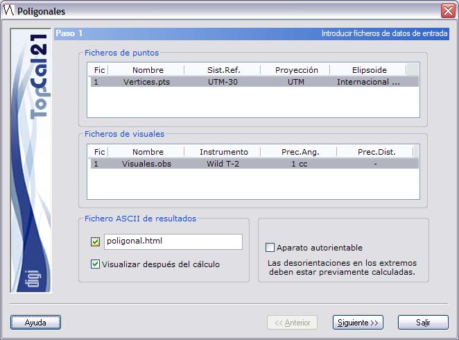

# Paso 1: Introducir ficheros de datos de entrada
<!-- id: topcal21-poligonales-paso-1-introducir-ficheros-de-datos-de-entrada -->

Este es el primer paso para calcular las poligonales. Los datos requeridos son los siguientes:

* **Ficheros de puntos**: Se seleccionarán los ficheros de puntos del proyecto que se desean utilizar en la poligonal. Sólo se podrá continuar el cálculo si todos los ficheros de puntos seleccionados están referidos al mismo sistema de referencia.
* **Ficheros de visuales**: Se seleccionarán los ficheros de observaciones del proyecto que contienen las visuales utilizadas en el cálculo.
* **Ficheros de resultados**: Se escribirá el nombre del fichero de salida con los resultados del cálculo. Este archivo podrá ser del formato **html** o de formato **ASCII**. Si la extensión de este archivo es HTM o html se tomará como formato html y en caso contrario se tomará como formato ASCII. Este archivo se podrá visualizar (con el visor que se hubiese indicado en el cuadro de [Preferencias](../../opciones-de-visualizacion/preferencias.md) del menú [Editar](../../menus-de-la-aplicacion/menu-editar.md)) si se activa la casilla inferior denominada **Visualizar después del cálculo**. Si no se desea crear este archivo, se deberá desactivar la casilla que aparece a la izquierda del nombre. El archivo se creará en el directorio del proyecto.
* **Utilizar factor de escala**: Si el sistema de referencia de los ficheros de puntos seleccionados es local, se podrá activar esta casilla en caso de que se desee calcular las distancias utilizando dicho factor. Es útil cuando no se está utilizando un sistema proyectivo pero se desean reducir las distancias para simular el cálculo en proyección UTM. Sólo se mostrará en caso de seleccionar ficheros sin sistema proyectivo.
* **Aparato autorientable**: Este campo se deberá marcar únicamente si se dispone de un aparato de autorientación, como puede ser una poligonal realizada con brújula o con giróscopo. Si se activa esta casilla se tomará la desorientación en el primer punto con la declinación magnética del aparato en todos los puntos. No es necesario que se tengan todas las visuales recíprocas, pero al menos tiene que existir una visual en cada tramo.

Una vez introducidos estos datos se podrá pulsar el botón **Siguiente** para acceder al [Paso 2: Selección de puntos](paso-2-seleccion-de-puntos.md).
