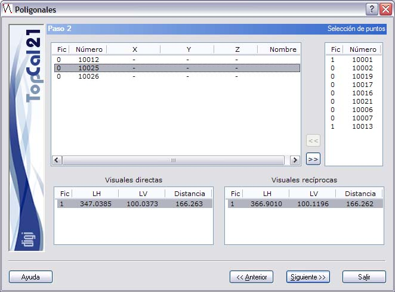

# Paso 2: Selección de puntos
<!-- id: topcal21-poligonales-paso-2-seleccion-de-puntos -->

Este es el segundo paso para el cálculo de poligonales.

Se muestra una pantalla con cuatro listados:

* **Listado de puntos disponibles**: Este listado está en la parte superior izquierda, y muestra todos los puntos disponibles en los ficheros seleccionados en el *Paso 1*. En este listado se deberán seleccionar los puntos que van a componer la poligonal. Para añadir un punto a la poligonal se deberá pulsar doble clic sobre el punto deseado o seleccionar dicho punto y pulsar el botón con el símbolo **>>**. Si se trata del cálculo de una poligonal que no es alterna, un punto sólo podrá ser añadido si existen visuales entre este punto y el anterior (en caso de no ser el primer punto). Este listado se va actualizando según la estación actual de la poligonal, de tal forma que sólo se mostrarán los puntos visados desde dicha estación, en los cuales se haya estacionado y visado a la estación actual, es decir, que tenga visual recíproca. En este listado aparecen los siguientes campos:
  * **Índice de fichero**: Indica el índice del fichero de puntos donde se encuentra almacenado el punto. Si este campo es igual a 0 indicará que el punto no tiene actualmente coordenadas y que, por tanto, no está almacenado en ningún fichero, sino que existen visuales desde la anterior estación a este punto.
  * **Número de punto**
  * **Coordenadas del punto**
* **Listado de puntos que componen la poligonal**: Este listado está en la parte superior derecha y muestra los puntos que componen la poligonal. Están ordenados según discurre la poligonal. Se podrá eliminar un punto de la poligonal pulsando el botón con el símbolo **&lt;&lt;**. Si se elimina un punto de en medio de la poligonal se eliminarán todos los puntos que están a partir de él. En este listado aparecen los siguientes campos:
  * **Índice de fichero**: Índice del fichero de puntos al que pertenece el punto.
  * **Número de punto**
* **Listado con las visuales directas**: Este listado está en la parte inferior izquierda y muestra las visuales disponibles desde la última estación de la poligonal al punto seleccionado en el listado de puntos disponibles. En caso de que hubieran varias visuales se podrá elegir qué visual se desea utilizar en el cálculo. En este listado aparecen los siguientes campos:
  * **Índice de fichero**
  * **Lectura horizontal**
  * **Lectura vertical**
  * **Distancia**
* **Listado con las visuales recíprocas**: Este listado está en la parte inferior derecha y muestra las visuales disponibles desde el punto seleccionado en el listado de puntos disponibles a la última estación de la poligonal. En caso de que hubieran varias visuales se podrá elegir qué visual se desea utilizar en el cálculo. En este listado aparecen los siguientes campos:
  * **Índice de fichero**
  * **Lectura horizontal**
  * **Lectura vertical**
  * **Distancia**

Sólo es necesario que exista una distancia en cada eje. En caso de existir dos distancias (directa y recíproca), se reducirán y se utilizará el promedio.

El botón **Siguiente** se habilita cuando la poligonal contiene al menos un eje. Las poligonales pueden ser:

* **Abiertas** o **Cerradas**: Son cerradas cuando la estación de salida coincide con la estación de llegada. En caso contrario son abiertas. Si la poligonal es cerrada y el distanciómetro utilizado tiene un error sistemático, el cierre no permite detectar ese error.
* **Encuadradas** o **no encuadradas**: Son encuadradas cuando se conocen las coordenadas de las estaciones de salida y de llegada. En caso contrario, serían no encuadradas. En este segundo caso no se pueden calcular los errores de cierre de la poligonal.

Cuando se haya compuesto la poligonal se puede pulsar al botón **Siguiente** para acceder al [Paso 3: Comprobación de distancias y desniveles](paso-3-comprobacion-de-distancias-y-desniveles.md) o volver al [Paso 1: Introducir ficheros de datos de entrada](paso-1-introducir-ficheros-de-entrada.md) pulsando el botón **Anterior**.
