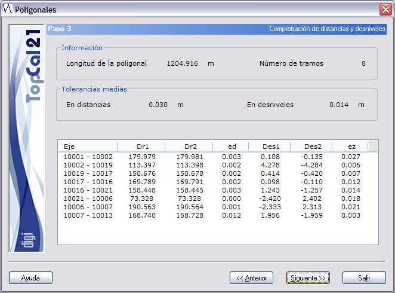

# Paso 3: Comprobación de distancias y desniveles
<!-- id: topcal21-poligonales-paso-3-comprobacion-de-distancias-y-desniveles -->

Este es el tercer paso para el cálculo de poligonales. En este paso se muestra información acerca de la poligonal calculada. Se muestran los diferentes ejes con las distancias y desniveles medidos. De esta manera, se pueden comparar ambos y comprobar si son tolerables para este tipo de observación y este instrumental.

En el caso de que la poligonal sea alterna, sólo se mostrará una distancia y un desnivel por eje.

En la parte superior del cuadro de diálogo se muestra la **Longitud** total de la poligonal y el **Número de tramos**. A continuación, se muestran las **tolerancias medias en distancias y desniveles**. Estos valores no deberían ser superados por la diferencia entre distancias y desniveles directos y recíprocos, respectivamente.

A continuación, se muestra la información de los ejes, estructurada en los siguientes campos:

* Eje
* Distancia reducida directa
* Distancia reducida recíproca
* Diferencia entre ambas distancias
* Desnivel directo
* Desnivel recíproco
* Diferencia entre ambos desniveles

Al llegar a este paso, el programa ya ha calculado la poligonal y muestra los primeros resultados, en este caso de comprobación. Se deberá cuidad que estos errores se mantengan dentro de las tolerancias calculadas, ya que el programa utilizará la media aritmética de ellos en cada eje para calcular las coordenadas de las estaciones. Si alguno de los ejes no fuera tolerable en distancia o desnivel y se detectara el error (en la visual directa o recíproca) se podrá desactivar dicha visual estableciendo el campo vertical o distancia a cero en el fichero original de visuales.

Si se aceptan los datos obtenidos se puede pulsar al botón **Siguiente** para acceder al [Paso 4: Resultados y cierres](paso-4-resultados-y-cierres.md) o volver al [Paso 2: Selección de puntos](paso-2-seleccion-de-puntos.md) pulsando el botón **Anterior**.
