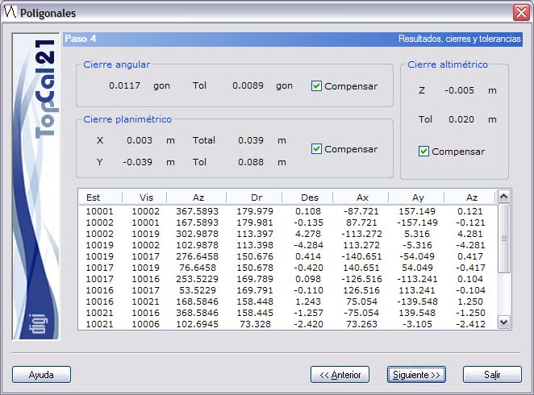

# Paso 4: Resultados y cierres
<!-- id: topcal21-poligonales-paso-4-resultados-y-cierres -->

Este es el cuarto paso para el cálculo de poligonales. En este paso se muestra más información acerca de la poligonal calculada. Se muestran los diferentes ejes y los errores de cierres obtenidos. En caso de no obtener resultados deseados, se podrá volver a los pasos anteriores para hacer las modificaciones oportunas.

En el caso de que la poligonal no sea encuadrada no se mostrarán los errores de cierre, no pudiendo comprobar la bondad de la observación.

La información viene estructurada en los siguientes campos:

* **Cierre angular**: Error de cierre angular obtenido al calcular la poligonal. A su derecha se muestra la **tolerancia**, calculada según las condiciones de observación y el instrumental utilizado. Este error podrá ser compensado en los diferentes ejes activando la casilla **Compensar**. Al activar o desactivar esta casilla se recalculan los datos inmediatamente.
* **Cierre planimétrico**: Errores de cierre en X e Y obtenidos al calcular la poligonal. A la derecha se muestra el **error total**, como la componente cuadrática de ambos errores y la **tolerancia** máxima. Estos errores podrán ser compensados en los diferentes ejes de manera proporcional a la distancia de estos activando la casilla **Compensar**. Al activar o desactivar esta casilla se recalculan los datos inmediatamente.
* **Cierre altimétrico**: Error de cierre en Z obtenido al calcular la poligonal. Asimismo, en la parte inferior se muestra la **tolerancia** máxima en este cierre. Este error podrá ser compensado en los diferentes ejes de manera proporcional a la distancia de estos activando la casilla **Compensar**. Al activar o desactivar esta casilla se recalculan los datos inmediatamente.
* **Listado con los ejes**: Los datos que se ofrecen son los siguientes:
  * *Número de estación*
  * *Número de punto visado*
  * *Acimut*
  * *Distancia reducida*
  * *Desnivel*
  * *Ax*: Incremento en la coordenada X del eje
  * *Ay*: Incremento en la coordenada Y del eje
  * *Az*: Incremento en la coordenada Z del eje

En este paso, se muestran los resultados junto con los errores de cierre. Estos errores se pueden compensar o no en tiempo real, por lo que si se desactivan cualquiera de las casillas de compensación se modificarán todos los cálculos del listado inferior.

Si se aceptan los datos obtenidos se puede pulsar al botón **Siguiente** para acceder al [Paso 5: Configurar datos de salida](paso-5-configurar-salidas-de-datos.md) o volver al [Paso 2: Selección de puntos](paso-2-seleccion-de-puntos.md) pulsando el botón **Anterior**.
