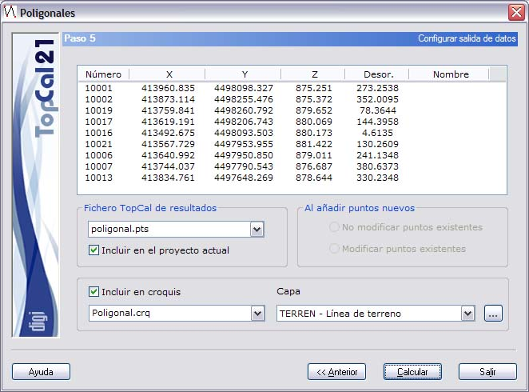

# Paso 5: Configurar salida de datos
<!-- id: topcal21-poligonales-paso-5-configurar-salida-de-datos -->

Este es el quinto y último paso en el cálculo de poligonales.

Se muestra una pantalla con las coordenadas finales calculadas y la forma de salvar dichas coordenadas. Además, se podrá generar un croquis con la situación de las estaciones de la poligonal. Se muestran los siguientes campos:

* **Coordenadas finales**: Se muestra un listado con los puntos nuevos calculados, sus coordenadas y su desorientación.
* **Fichero TopCal de resultados**: Se podrá seleccionar el nombre del fichero TopCal donde se almacenarán los puntos. Se podrá elegir alguno de los archivos existentes o generar un archivo nuevo. Si se desea generar un archivo nuevo, se podrá elegir añadir o no el fichero al proyecto actual.
* **Modo de añadir puntos**: Si el fichero de puntos no es nuevo se podrá elegir modificar o no los puntos con el mismo número que se encuentren en el fichero de salida elegido.
* **Croquis**: Se podrá seleccionar el nombre del fichero TopCal de croquis donde se registrará una línea que une las diferentes estaciones de la poligonal. Se podrá elegir alguno de los archivos existentes o generar un archivo nuevo. Además, se podrá indicar la **capa** en la que se registrará dicha línea.

Una vez que se hayan configurado los datos de salida, se podrá terminar el proceso pulsando el botón **Calcular** o volver al paso anterior [Paso 4: Resultados y cierres](paso-4-resultados-y-cierres.md) pulsando el botón **Anterior**.
