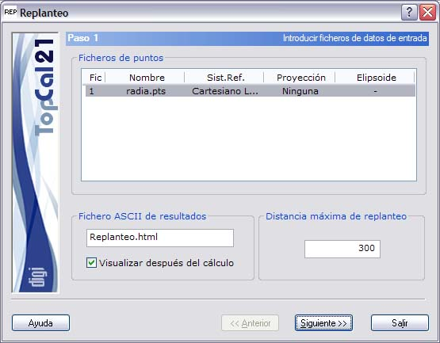

# Paso 1: Introducir ficheros de datos de entrada
<!-- id: topcal21-replanteo-paso-1-introducir-ficheros-de-datos-de-entrada -->

Este es el primer paso para calcular los datos de replanteo. Los datos requeridos son los siguientes:

* **Ficheros de puntos**: Se seleccionarán los ficheros de puntos del proyecto que se desean utilizar en el replanteo. Sólo se podrá continuar el cálculo si todos los ficheros de puntos seleccionados están referidos al mismo sistema de referencia.
* **Distancia máxima de replanteo**: Se designará una distancia máxima de replanteo de forma general. Esta distancia podrá ser cambiada posteriormente, de forma particular, para cada estación. A partir de dicha distancia no se calcularán los datos de replanteo desde una determinada estación.
* **Ficheros de resultados**: Se escribirá el nombre del fichero de salida con los resultados del cálculo. Este archivo podrá ser del formato **html** o de formato **ASCII**. Si la extensión de este archivo es HTM o html se tomará como formato html y en caso contrario se tomará como formato ASCII. Este archivo se podrá visualizar (con el visor que se hubiese indicado en el cuadro de [Preferencias](../../opciones-de-visualizacion/preferencias.md) del menú [Editar](../../menus-de-la-aplicacion/menu-editar.md)) si se activa la casilla inferior denominada **Visualizar después del cálculo**. El archivo se creará en el directorio del proyecto.

Una vez introducidos estos datos se podrá pulsar el botón **Siguiente** para acceder al [Paso 2: Selección de puntos estación](paso-2-seleccion-de-puntos-estacion.md).
