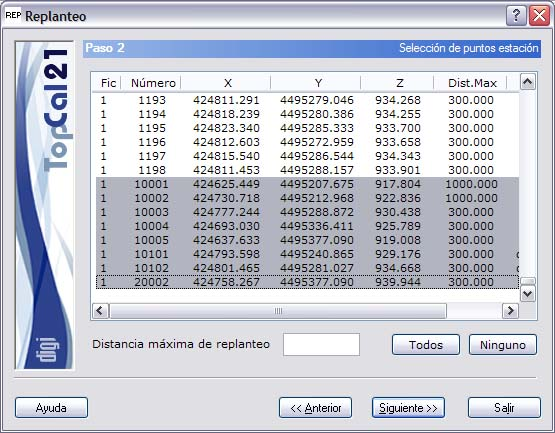

# Paso 2: Selección de puntos estación
<!-- id: topcal21-replanteo-paso-2-seleccion-de-puntos-estacion -->

Este es el segundo paso para el cálculo de los datos de replanteo.

Se muestra una pantalla con los puntos con coordenadas almacenados en los ficheros de puntos seleccionados en el *Paso 1*. Se deberán seleccionar los puntos estación desde donde se calcularán los datos de replanteo del resto de los puntos.

El listado que se muestra contiene los siguientes campos:

* **Índice de fichero**: Indica el índice del fichero de puntos donde se encuentra almacenado el punto.
* **Número de punto**
* **Coordenadas del punto**
* **Distancia máxima de replanteo**

Se podrán seleccionar múltiples puntos utilizando la tecla *\[CTRL\]* y pulsando con el botón izquierdo del ratón sobre los puntos deseados. Si se pulsa sobre un punto ya seleccionado, éste se deselecciona.

También se pueden seleccionar puntos dispuestos en rangos, pulsando la tecla *\[MAYÚSCULAS\]* y el botón izquierdo del ratón sobre los puntos límite que definen el rango.

De la misma forma, se pueden utilizar los botones de **Todos** o **Ninguno** para seleccionar o deseleccionar todos los puntos.

Además, aparece un campo denominado **Distancia máxima de replanteo**, útil para cambiar la distancia para cada estación de forma independiente. Si se desea cambiar esta distancia para varios puntos, es posible seleccionar los deseados y escribir la nueva distancia, siendo ésta actualizada para todos ellos.

Cuando se hayan seleccionado los puntos deseados se puede pulsar al botón **Siguiente** para acceder al [Paso 3: Selección de puntos visados](paso-3-seleccion-de-puntos-visados.md) o volver al [Paso 1: Introducir ficheros de datos de entrada](paso-1-introducir-ficheros-de-datos-de-entrada.md) pulsando el botón **Anterior**.
