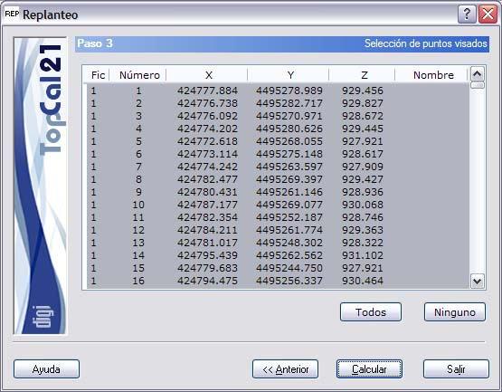

# Paso 3: Selección de puntos visados
<!-- id: topcal21-replanteo-paso-3-seleccion-de-puntos-visados -->

Este es el tercer y último paso para el cálculo de los datos de replanteo.

Se muestra una pantalla con los puntos con coordenadas almacenados en los ficheros de puntos seleccionados en el *Paso 1* y que no hayan sido seleccionados como puntos estación en el *Paso 2*. Ahora, se deberán seleccionar los puntos visados, para los que se calcularán los datos de replanteo desde los puntos estación seleccionados en el paso anterior.

El listado que se muestra contiene los siguientes campos:

* **Índice de fichero**: Indica el índice del fichero de puntos donde se encuentra almacenado el punto.
* **Número de punto**
* **Coordenadas del punto**

Se podrán seleccionar múltiples puntos utilizando la tecla *\[CTRL\]* y pulsando con el botón izquierdo del ratón sobre los puntos deseados. Si se pulsa sobre un punto ya seleccionado, éste se deselecciona.

También se pueden seleccionar puntos dispuestos en rangos, pulsando la tecla *\[MAYÚSCULAS\]* y el botón izquierdo del ratón sobre los puntos límite que definen el rango.

De la misma forma, se pueden utilizar los botones de **Todos** o **Ninguno** para seleccionar o deseleccionar todos los puntos.

Una vez que se hayan configurado los datos de salida, se podrá terminar el proceso pulsando el botón **Calcular** o volver al paso anterior [Paso 2: Selección de puntos estación](paso-2-seleccion-de-puntos-estacion.md) pulsando el botón **Anterior**.
